# Design Doc: Per-Run Databricks Compute Cost — Revision 2 (review incorporated)

> **Status:** Revision 2, plus architecture diagrams (Part 0) and an implementation and delivery roadmap (Part H), added 2026-11-20. Awaiting sign-off.
>
> **Known gap:** Parts D and E say "Unchanged from Revision 1" for sections that are not in this repository's history: D.1–D.4, D.6–D.8, E.1–E.3 and E.8–E.9, plus the A.2 sample tables. `docs/plans/2026-11-19-cost-design.md` has a single commit and it already holds Revision 2. Diagram 0.5 stands in for D.1 and E.1. D.3 (prerequisites), D.4 (`databricks.yml`), E.3, E.8 (cost) and E.9 (comparison) must be recovered or rewritten before work package P2.3 (H.7, risk 11).

## Context
Calculators run on Azure Databricks **ephemeral job clusters**, launched by **MEG**: Airflow → EDF → MEG → a Databricks job run. We need a **$ cost per calculator run** (DBU + Azure VM), ingested into `dashboard-service` and queryable via REST. An external static review of Revision 1 found accuracy and reconciliation gaps. Each one was checked against current Microsoft Learn and Databricks docs; all seven are confirmed (table below).

**Scope:** design only; there is no code.

Confirmed decisions:
- Service `runId` == MEG runId == tag `megdp-run-id`.
- Reporting date comes from Databricks job parameters.
- Prices come from a config-file rate card.
- The deliverable is the doc only.
- **Discovery is a stateless overlap rescan** (no watermark).
- **Every item is stored and linked at read time** (no replay queue).

Verified facts behind Revision 2:
- **`billing.usage`:**
  - Original records arrive "typically within 12 hours". That timing applies only to `ORIGINAL` records; corrections are unbounded.
  - `ingestion_date` (date) exists, and `record_id` is a top-level column.
  - A RETRACTION is "identical to the ORIGINAL except `usage_quantity`". A RESTATEMENT has "the correct fields".
  - `usage_metadata.node_type` exists but does not distinguish driver from worker. `product_features.is_photon` exists.
- **`compute.node_timeline`:** "Nodes that ran for less than 10 minutes might not appear".
- **`compute.instance_events`** (Public Preview):
  - Columns: `instance_id`, `event_time`, `event_type`, `state`, `node_type`, `availability_type` (ON_DEMAND/SPOT), and `cluster_id`.
  - States: INSTANCE_LAUNCHING, INSTANCE_READY, INSTANCE_PLACED, INSTANCE_TERMINATED.
  - `cluster_id` is filled only on INSTANCE_PLACED, and there is no driver flag.
- **Jobs repair:** reruns happen "as part of the original job run", with the same `run_id`. Repair works only for jobs with two or more tasks. A single-task job is retried with Run now, which creates a new `run_id`.
- **This repo:** `RunStatus.isTerminal()` is `status != RUNNING`, and `reWriteBatchedInserts` is off.

---

## Revision history and review disposition

| # | Review finding | Verdict | Where fixed |
|---|---|---|---|
| 1 | `node_timeline` can miss short-lived nodes, so VM cost is incomplete | Confirmed | A.4 VM basis and completeness rules, C.1 DBU lines by `node_type`, F.3 pricer, Phase 0 `instance_events` evaluation |
| 2 | 5-day window and FINAL at 72 h don't reconcile late corrections; "1–6 h" was wrong | Confirmed | A.6 settlement policy (revisable), B.1 latency now 12 h, C.1 discovery on `ingestion_date`, D.7 outage runbook |
| 3 | `MAX(tag)` / `collect_set(cluster_id)` keep retracted metadata | Confirmed | C.1 nets at every attribution dimension before deriving correlation and clusters; ambiguity → REJECTED |
| 4 | A late repair can replace the lifetime total with a partial one | Confirmed. Applies only to multi-task jobs, but the fix also covers any late usage | C.1 discover-then-full-history; `historyTruncated` guard; Phase 0 multi-task check |
| 5 | Read SQL returns PROVISIONAL/ESTIMATED with no rows, and SUM hides unpriced attempts | Confirmed | F.4 gates on `COUNT(*)`; mapping done in Java; total is null unless every attempt is priced; tests |
| 6 | Effective-dated pricing needs usage intervals; reprice locally | Confirmed. Day granularity matches the rate card | C.1 lines carry `usageDate`; F.3 admin reprice from `usage_detail`; source vs valuation timestamps |
| 7 | Monitoring tracks activity, not coverage; unresolved items are lost after 5 d | Confirmed. Implemented as store-all plus link-at-read | F.3 coverage job and gauges, `compute_cost_export_log`, F.6 alerts |
| — | Non-UC path under-specified | Confirmed | B.2 reduced to an outline that needs its own design spike; output ESTIMATED throughout |
| — | Choose the transport on ownership and existing infrastructure too | Accepted | B.3 decision criteria |

---

## Part 0 — Architecture

This part is the picture of Parts A–F: what talks to what (0.2, 0.3), how data moves (0.4, 0.5), how a cost row is received, priced and stored (0.6–0.8), how it is read (0.9) and where it runs (0.10). Section references (A.4, C.1, F.3 …) point to the detailed specification. Diagrams are Mermaid.

### 0.1 Key design decisions

| # | Decision | Why | Detail |
|---|---|---|---|
| 1 | Source of truth is the Databricks **system tables** (Unity Catalog), not the Jobs REST API | Billed DBUs per run, including corrections. No N+1 calls, no 429 handling, no 404 after cluster purge (A.2) | B.1 |
| 2 | The exporter ships **facts** (DBU lines, node-seconds). The service owns **prices** | One rate card. Repricing never needs a re-export | A.4, A.5, F.3 |
| 3 | Totals are **cumulative per Databricks job run**, never deltas | A late repair or correction updates the lifetime total. It cannot replace it with a partial one | B.1, C.1 |
| 4 | Discovery is a **stateless overlap rescan** (7 d), run hourly | No watermark to lose. Outage recovery is one run with a larger window | B.1, D.6 |
| 5 | Rows are keyed `(workspace_id, job_run_id)` and **linked to `calculator_runs` at read time** on `(run_id, reporting_date)` | Cost can arrive before or after the run row. No replay queue | A.1 #6, F.1, F.4 |
| 6 | **Unknown is NULL, never 0.** VM completeness is explicit | Short-lived nodes can be missing from `node_timeline` | A.4, F.4 |
| 7 | Settlement is **derived at read time**. Nothing is immutable | Corrections are unbounded in time | A.6 |
| 8 | **One receiver, two interchangeable transports** (Databricks job or Airflow task) | Chosen in Phase 0 on connectivity, ownership and existing infrastructure | B.3, Parts D and E |

### 0.2 System context

Who produces the data, who moves it, and who consumes it. Solid lines are new in this design. The dotted line is the existing run-lifecycle ingestion.

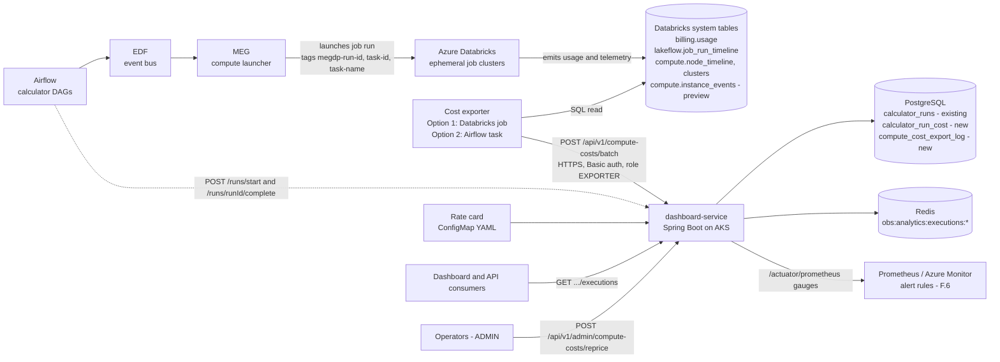

### 0.3 Component view

The three planes and the contracts between them. The exporter is deliberately thin: it reads, nets corrections, and ships facts. Everything that needs prices, state or judgment is in the service.

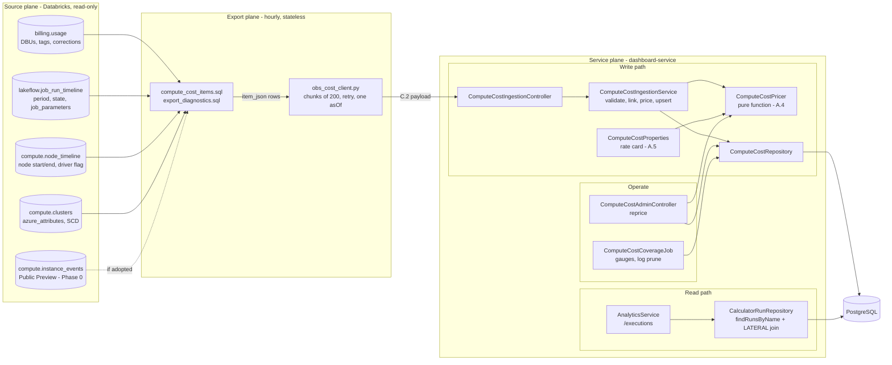

### 0.4 Exporter query pipeline (C.1)

One SQL statement, six protections. Each stage exists to defeat a specific accuracy gap found in the review (Revision history #1–#4).

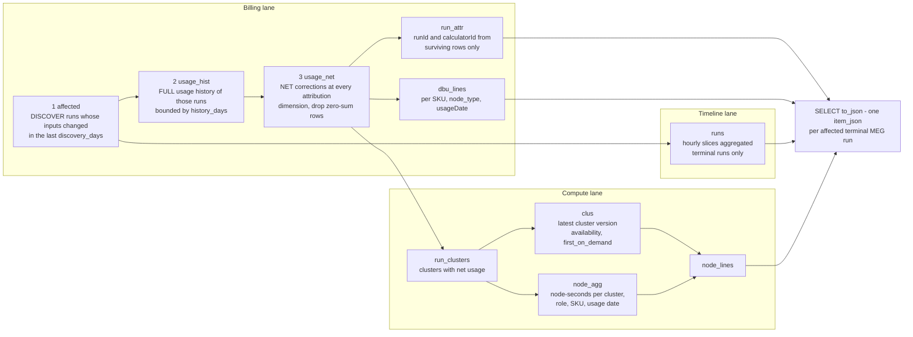

| Stage | Protects against |
|---|---|
| 1 `affected` | Missing late corrections: discovery is by billing `ingestion_date`, not usage date |
| 2 `usage_hist` | A repair or late usage replacing the lifetime total with a partial one |
| 3 `usage_net` | Retracted tags and clusters surviving into correlation |
| `run_attr` | Silent `MAX(tag)` choices: ambiguity becomes `correlationIssue` and the item is REJECTED |
| `dbu_lines` with `node_type` | Unverifiable VM completeness: the service can compute DBU-implied hours |
| `node_lines` | Per-minute `node_timeline` rows blowing up payload size |

### 0.5 Export cycle: both transports

Only one transport is built (B.3). Both end in the same shared client and the same endpoint. These two diagrams are written from D.5, E.4–E.5 and C.3 and stand in for the Revision 1 sequence diagrams D.1 and E.1, which are missing (see the Known gap note at the top of this doc).

**Option 1: Databricks job posts directly.**

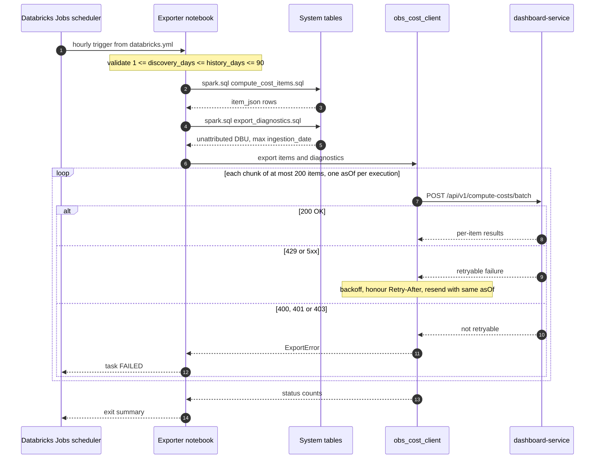

**Option 2: Airflow pulls through the SQL Statement Execution API, then posts.**

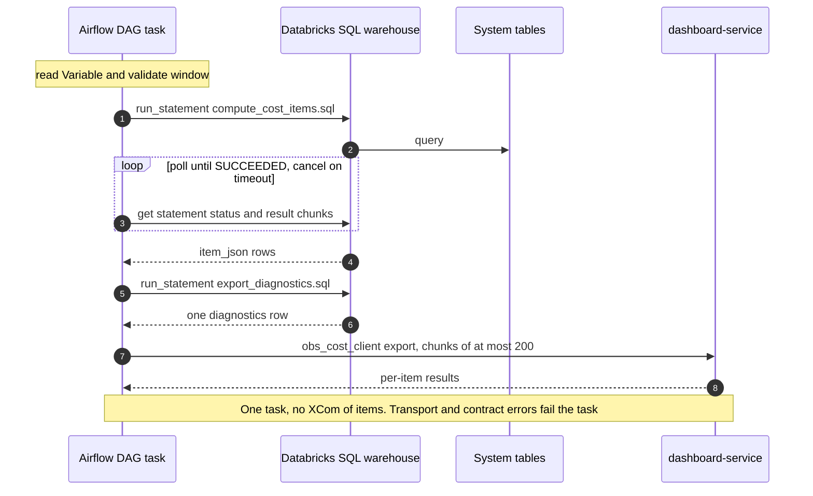

### 0.6 Ingestion transaction (F.3)

One request is one transaction. Per-item problems never fail the request: they become item statuses. The exporter fails only on transport or envelope errors.

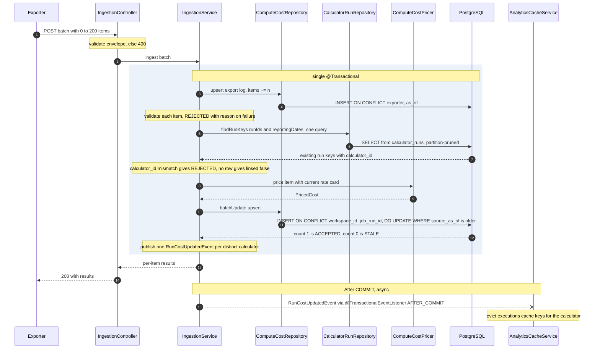

| Item status | Meaning |
|---|---|
| `ACCEPTED` | Stored. `linked=false` if the run row does not exist yet. `pricingStatus=UNPRICED` if a rate is missing |
| `STALE` | Stored `source_as_of` is the same or newer. Normal under overlap and retries |
| `REJECTED` | Not stored. `MISSING_FIELD`, `NEGATIVE_QUANTITY`, `AMBIGUOUS_RUN_TAG`, `AMBIGUOUS_CALCULATOR_TAG`, `CALCULATOR_MISMATCH` |

A zero-item batch is a heartbeat: it only upserts the export log, so liveness and diagnostics keep flowing.

### 0.7 Pricing flow (A.4)

How one item becomes dollars. The VM branch runs per `(nodeType, usageDate)`. The run-level `vmCompleteness` is the worst result over all pairs.

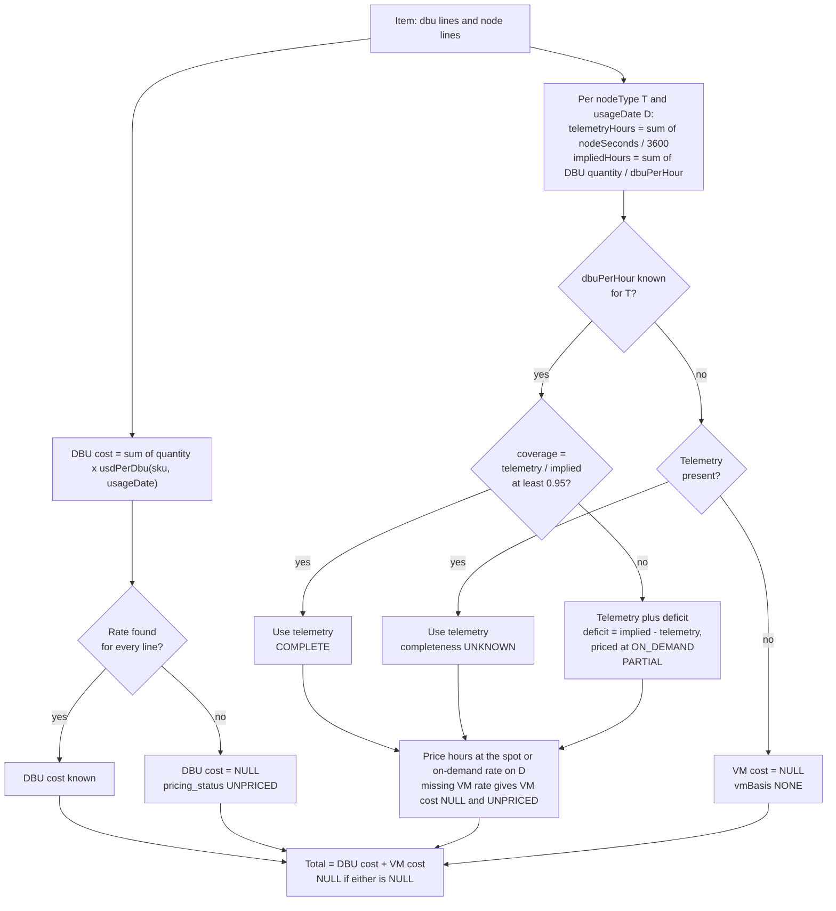

Two properties to preserve in code and review: a run that is missing from `node_timeline` (shorter than 10 minutes) lands in the **PARTIAL / DBU_IMPLIED** branch with coverage 0, and is never priced at 0. A missing rate never yields a partial total: the component is NULL and `pricing_status` is UNPRICED.

### 0.8 Data model and row lifecycle

`calculator_run_cost` is keyed by Databricks identity and carries the calculator-run key as plain columns. There is no foreign key, which is why cost can arrive before its run.

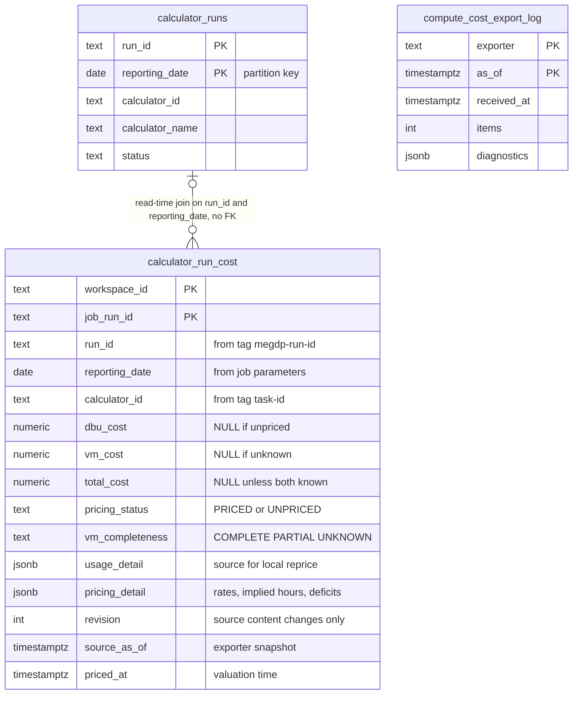

Lifecycle of one cost row. Settlement is not stored: it is computed on read from `period_end` and `settle-days`.

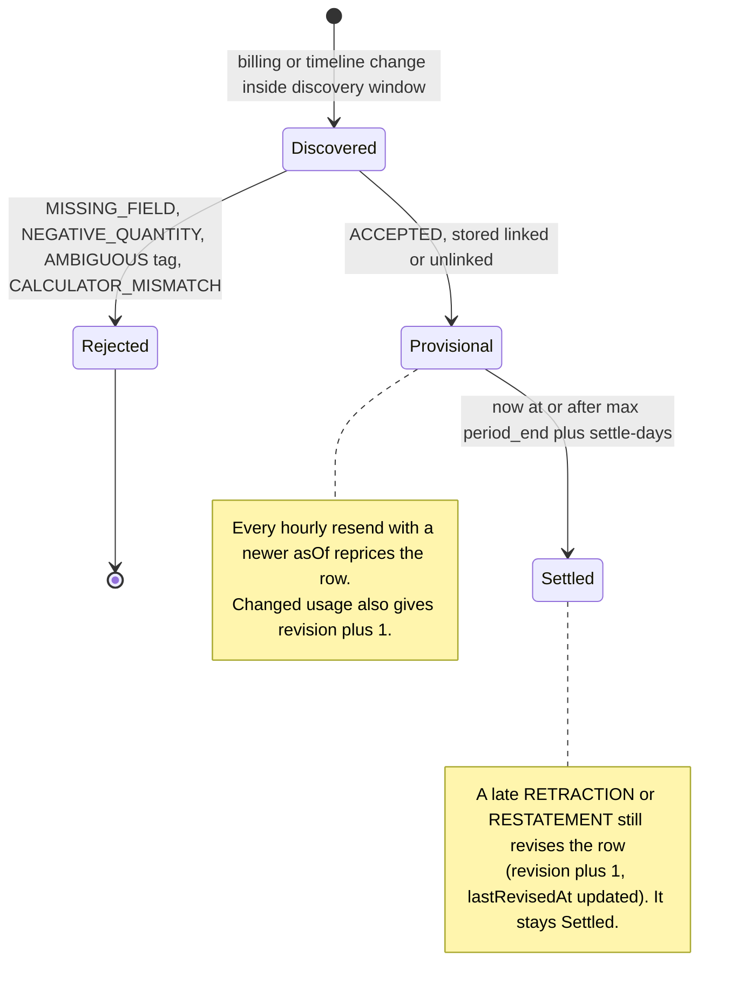

Three attributes vary independently of the lifecycle and are all visible on the read API: **linked** (does `calculator_runs` have the row yet), **pricing** (`PRICED` / `UNPRICED`, fixed by a rate-card fix plus admin reprice, which changes valuation only and never `revision`) and **completeness** (`COMPLETE` / `PARTIAL` / `UNKNOWN`).

### 0.9 Read path and cache (F.4)

`/executions` gains an additive, nullable `cost` object on each run data point. Cost is aggregated per `(run_id, reporting_date)` in SQL, and the null-versus-total decision is made in Java so that missing data can never look like a zero.

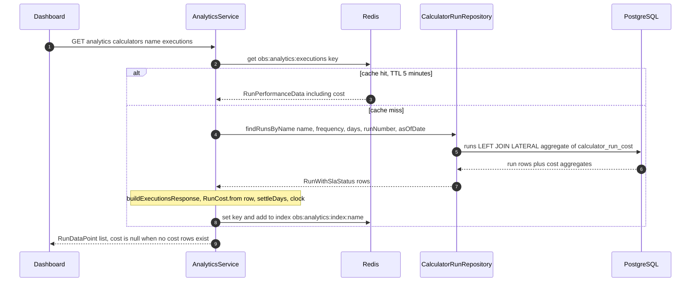

- **Invalidation** is event-driven: `RunStartedEvent`, `RunCompletedEvent`, `SlaBreachedEvent` and the new `RunCostUpdatedEvent` all evict the calculator's `executions` keys after commit (`AnalyticsCacheService.evictForCalculator`).
- **Settlement flips with time, not events.** A row turning `PROVISIONAL` → `SETTLED` fires no event, so the 5-minute TTL bounds the staleness.
- **Attempts are summed.** Retries (Run now) create new job runs. The read side adds them per calculator run. `totalCost` is null unless every attempt is priced, and `knownSubtotal` carries the partial figure.

### 0.10 Deployment and trust boundaries

Only one of Option 1 and Option 2 is deployed.

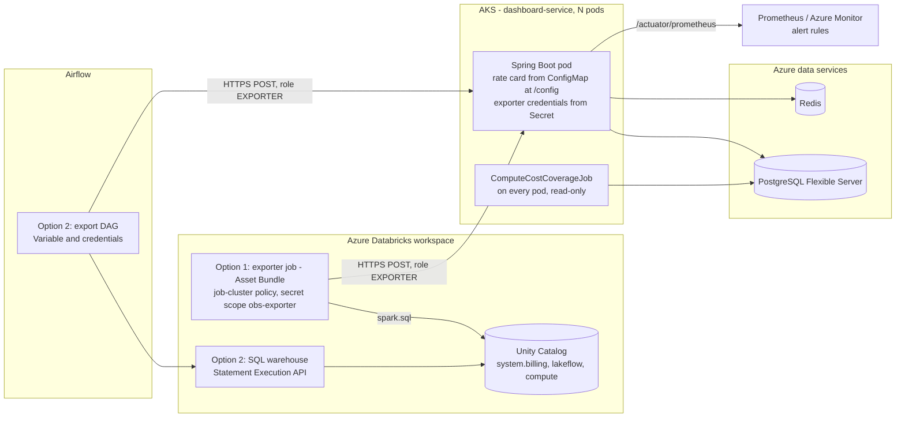

Security and trust, in short:
- The exporter has its own Basic-auth user with role `EXPORTER`, allowed only on `POST /api/v1/compute-costs/**` (F.3). Repricing needs `ADMIN` through the existing `/api/v1/admin/**` matcher.
- The client refuses a non-`https://` base URL. Credentials live in a Databricks secret scope (Option 1) or in Airflow-managed credentials (Option 2). The ConfigMap holds prices only.
- The exporter identity needs read-only `SELECT` on the system schemas it queries and nothing else in Databricks.
- Open item (F.3, inherits TD-7): least privilege on the other routes, and the plaintext Basic-auth password.

---

## Part A — Foundation

### A.1 Assumptions
1. One calculator per Databricks job run; each run gets its own job cluster or clusters.
   - **Retries** (Run now) create new job runs, which the service sums per calculator run.
   - **Repairs** keep the same `job_run_id` and are possible only for multi-task jobs. Phase 0 determines which case MEG uses. The design handles both.
2. Classic jobs compute, Premium tier. No serverless and no pools.
3. Tag `megdp-run-id` == service `runId`. Tag `task-id` == `calculator_runs.calculator_id`, which is the integrity check. Tag `task-name` is used for display only.
4. `reporting_date` comes **only** from job parameters, never from the run's start time.
5. The rate card config file is the single price source, and the service does all pricing and repricing.
6. **Cost rows are keyed by Databricks identity** `(workspace_id, job_run_id)` and carry `(run_id, reporting_date)` from tags and parameters. They do not depend on the `calculator_runs` row existing.

### A.2 Analysis of the two samples
Unchanged from Revision 1. It has two tables (`# | Issue | Lines | Impact`) for sample 1 (REST) and sample 2 (SQL).

Sample 1 findings:
- Cost fields hardcoded to 0 (L343-347).
- `min_workers` used as the worker count (L434).
- Silent defaults (L282-286, L355-358).
- 404 after cluster purge (L170-175).
- `SPOT_WITH_FALLBACK_AZURE` missed (L455, L483).
- Top-level durations are 0 for multi-task runs (L270-276).
- Only `tasks[0]` considered (L386).
- Wrong reporting date and frequency (L527-528).
- `eastus2` hardcoded (L196).
- N+1 calls with no 429 handling (L119-157, L231-238).
- Exceptions swallowed (L244-247).
- Naive datetimes and `utcnow()` (L260, L348).
- Notebook PAT (L15-21).

Sample 2 findings:
- Excludes the Photon SKU (L50).
- No per-run grain (L142-152).
- Overlap join drops spin-up/teardown DBUs (L102-108, L120, L138).
- No price and no VM data.
- `create_time` used instead of `change_time` (L18-20).
- No time predicate (L54-56).
- Synthetic id (L27-39).
- Only `compute_ids[0]` and hourly slices not aggregated (L66).
- Untagged rows dropped (L150).
- Catalog hardcoded (L3-5).

The Revision 2 addition to sample 2's row 9: like the first draft of C.1 in Revision 1, it also carries tags from retracted records. C.1 now fixes that.

**Verdict:** the system-tables approach wins. Sample 1, hardened, is only the starting point for the non-UC spike.

### A.3 Correlation (equality joins only; corrections netted first)
```
1. Net billing rows by (job_run_id, cluster_id, node_type, sku, usage_date, megdp-run-id, task-id, task-name);
   drop combinations whose net |quantity| ≤ 1e-9 (fully retracted).
2. From the SURVIVING rows only:
     runId        = the single distinct megdp-run-id   (0 → not a MEG run, excluded; >1 → AMBIGUOUS_RUN_TAG)
     calculatorId = the single distinct task-id        (>1 → AMBIGUOUS_CALCULATOR_TAG)
     clusters     = distinct cluster_id with net usage (a cluster corrected away no longer attracts VM time)
3. reporting_date = job_run_timeline.job_parameters[<key>] (latest slice)
4. cluster_id → node_timeline / clusters (and instance_events if adopted in Phase 0)
```
Ambiguous mappings are **sent and REJECTED with a reason**, never resolved by picking `MAX`.

### A.4 Cost model (service-side, priced per usage date)
```
For every line, the rate in force is the one effective on that line's usageDate (UTC).

DBU$   = Σ_dbuLine quantity × usdPerDbu(skuName, usageDate)                         dbuBasis = BILLED (UC) | ESTIMATED (non-UC)

VM hours, per (nodeType T, usageDate D):
  telemetryHours(T,D) = Σ nodeLine.nodeSeconds / 3600                      (node_timeline, or instance_events if adopted)
  impliedHours(T,D)   = Σ dbuLine.quantity(T,D) / dbuPerHour(T, photon(sku))  (billing is complete by construction)
  coverage(T,D)       = telemetryHours / impliedHours
  if impliedHours unknown (no dbu-per-hour for T)         → use telemetry; completeness UNKNOWN
  elif coverage ≥ completenessThreshold (default 0.95)    → use telemetry; COMPLETE
  else                                                    → telemetry + deficit (impliedHours − telemetryHours)
                                                            priced at ON_DEMAND (conservative upper bound); PARTIAL
  no telemetry and no implied hours                       → VM$ = NULL (unknown — never 0)

VM$    = Σ telemetry nodeLines × vmRate(vmSku, effectiveAvailability, D) + Σ deficit × onDemandRate(T, D)
         effectiveAvailability = ON_DEMAND if availability = ON_DEMAND_AZURE or (role = DRIVER and firstOnDemand ≥ 1)
                                 else SPOT                    (instance_events, if adopted, supplies the real per-instance value)
Total$ = DBU$ + VM$; NULL if either is NULL (pricing_status = UNPRICED when a rate is missing)
Money: BigDecimal; intermediate scale 6; stored HALF_UP scale 4.
vmBasis ∈ {INSTANCE_EVENTS, NODE_TIMELINE, NODE_TIMELINE_PLUS_DBU_IMPLIED, DBU_IMPLIED, NONE}
vmCompleteness ∈ {COMPLETE, PARTIAL, UNKNOWN}  (run-level = worst over (T,D); vmCoverageRatio = Σtelemetry/Σimplied)
```
Documented limits:
- DBU-implied hours can omit VM provisioning time that is billed by Azure but carries no DBU.
- The deficit is priced at on-demand rates, so PARTIAL runs carry an upper-bound bias.
- Without `instance_events`, spot→on-demand fallback per worker is invisible.

Phase 0 decides between `NODE_TIMELINE` and `INSTANCE_EVENTS` as the telemetry source, and tunes the completeness threshold.

### A.5 Rate card (ConfigMap → `spring.config.import=optional:file:/config/compute-cost-rates.yml`)
- Lists, not maps.
- Fail fast at startup on a duplicate `(sku, effective-from)` or a negative rate.
- The rate in force is the one with the greatest `effective-from` ≤ the line's `usageDate`.
- `dbu-per-hour` and `photon-dbu-per-hour` are now **required for every VM SKU on both paths**, because they drive the completeness check.
- A missing rate → `UNPRICED`; fix the card, then run the admin reprice (F.3).
```yaml
observability:
  compute-cost:
    currency: USD
    rate-card-version: "2026-11"
    region: northeurope
    completeness-threshold: 0.95
    settle-days: 7
    dbu-rates:
      - { sku: "PREMIUM_JOBS_COMPUTE",          usd-per-dbu: 0.30, effective-from: 2026-01-01 }
      - { sku: "PREMIUM_JOBS_COMPUTE_(PHOTON)", usd-per-dbu: 0.30, effective-from: 2026-01-01 }
    vm-rates:
      - { vm-sku: "Standard_E8ds_v5", on-demand-usd-per-hour: 0.576, spot-usd-per-hour: 0.12,
          dbu-per-hour: 2.0, photon-dbu-per-hour: 4.0, effective-from: 2026-01-01 }
```
All values are placeholders, to be filled from the contract, the Azure price sheet and the Databricks DBU/hr table.

### A.6 Settlement and revision semantics (new)
- **Nothing is ever immutable.** Every accepted resend that changes source content increments `revision` and sets `last_revised_at`.
- **Settlement is an operational policy, not a data guarantee.** It is **derived at read time** as `SETTLED` when `now ≥ max(period_end) + settle-days` (default 7 d), else `PROVISIONAL`. It is not stored, so it can never go stale. A correction after settlement still revises the row; the read API shows `settlement=SETTLED` with a higher `revision` and a newer `lastRevisedAt`.
- **Two separate timelines:**
  - **Source freshness:** `source_as_of` (exporter snapshot) and `source_ingested_through` (max billing `ingestion_date` seen).
  - **Valuation:** `priced_at` and `rate_card_version`. Repricing changes only valuation.

---

## Part B — Data sourcing paths

### B.1 Path UC: system tables available (recommended)
- Sources: `billing.usage`, `lakeflow.job_run_timeline`, `compute.node_timeline`, `compute.clusters`, and optionally `compute.instance_events` (Public Preview; Phase 0).
- Original billing rows arrive in about **12 h**; corrections have no bound.
- **Exporter model (per execution):**
  1. **Discover** affected runs. Either billing rows with `ingestion_date ≥ today − discovery_days` (default 7: new originals, retractions, restatements, repair usage), or timeline slices ending in the same window (new terminal or repaired states).
  2. **Fetch the full history** of each affected run, bounded by `history_days` (default 62, under the 90-day `node_timeline` retention). Usage on the boundary day sets `historyTruncated=true`, which the service shows as `complete=false`.
  3. **Net corrections** (A.3) and **send complete cumulative totals**.

  Because a resend always carries the full lifetime, a repair on day 10 updates the day-1 total; it does not replace it.
- **Stateless:** a window of `discovery_days` overlaps hourly runs about 168 times. An exporter outage longer than `discovery_days` triggers the staleness alert and is recovered with one run at a larger `discovery_days` (D.7).
- Works with both delivery options.

### B.2 Path non-UC: no Unity Catalog (outline only; requires its own design spike before implementation)
- Sources: Jobs API 2.2 `runs/list` and `runs/get` (including `repair_history`), `clusters/get` and `clusters/events`. Same item JSON with `source=JOBS_REST_API` and `dbu: []`, plus `photon`. The service estimates DBUs, giving `dbuBasis=ESTIMATED` and `vmCompleteness=UNKNOWN`, **always**.
- Unresolved design questions the spike must specify:
  1. Event integration boundaries: which cluster event types bound node lifetime, and how gaps and pagination truncation are handled.
  2. Incomplete histories: clusters are purged ~30–60 d after termination and runs kept ~60 d. Define detection and `historyTruncated` semantics.
  3. Driver lifetime: CREATING→TERMINATED versus RUNNING→TERMINATING.
  4. Repair traversal: walk `repair_history` and attribute every repair's clusters to the run.
  5. Rate-limit budget per execution.
- Delivery uses Option 1's transport, or the same collector as an Airflow task. Option 2 does not apply.

### B.3 Decision rules (Phase 0)
- **Path:** `SELECT max(usage_date) FROM <catalog>.billing.usage` succeeds and is ≤ 1 day old → Path UC. Build one path only.
- **Transport** is weighed on three criteria, not connectivity alone:
  1. **Connectivity:** the D.3.6 health check.
  2. **Ownership:** who operates and is on call for Databricks jobs versus Airflow DAGs.
  3. **Existing infrastructure:** an existing Asset Bundle CI/CD and job-cluster policy (favours Option 1), or an existing SQL warehouse and the Airflow framework release train (favours Option 2).

  Record the choice and the reasons in the doc.

---

## Part C — Shared exporter artifacts

### C.1 `compute_cost_items.sql`: discover → full history → net → one `item_json` per affected terminal run
Parameters: `:catalog` STRING, `:discovery_days` INT (7), `:history_days` INT (62), `:reporting_date_param` STRING. It runs unchanged through `spark.sql(text, args=…)` and the Statement Execution API. `try_element_at` keeps map lookups null-safe under ANSI. Needs DBR/DBSQL with `IDENTIFIER()`, named markers and `GROUP BY ALL` (target ≥ 14.3 LTS).
```sql
WITH affected AS (                     -- (1) DISCOVER: runs whose inputs changed within the overlap window
  SELECT DISTINCT CAST(workspace_id AS STRING) AS workspace_id,
                  CAST(usage_metadata.job_run_id AS STRING) AS job_run_id
  FROM IDENTIFIER(:catalog || '.billing.usage')
  WHERE ingestion_date >= date_sub(current_date(), :discovery_days)      -- originals, retractions, restatements, repairs
    AND billing_origin_product = 'JOBS'
    AND usage_metadata.job_run_id IS NOT NULL
  UNION
  SELECT DISTINCT CAST(workspace_id AS STRING), CAST(run_id AS STRING)
  FROM IDENTIFIER(:catalog || '.lakeflow.job_run_timeline')
  WHERE period_end_time >= timestampadd(DAY, -:discovery_days, current_timestamp())
),
usage_hist AS (                        -- (2) FULL usage history of affected runs (bounded by history_days)
  SELECT CAST(u.workspace_id AS STRING)              AS workspace_id,
         CAST(u.usage_metadata.job_run_id AS STRING) AS job_run_id,
         u.usage_metadata.cluster_id AS cluster_id,
         u.usage_metadata.node_type  AS node_type,
         u.sku_name, u.usage_date, u.usage_quantity, u.ingestion_date,
         try_element_at(u.custom_tags, 'megdp-run-id') AS meg_run_id,
         try_element_at(u.custom_tags, 'task-id')      AS calculator_id,
         try_element_at(u.custom_tags, 'task-name')    AS calculator_name
  FROM IDENTIFIER(:catalog || '.billing.usage') u
  JOIN affected a
    ON a.workspace_id = CAST(u.workspace_id AS STRING)
   AND a.job_run_id   = CAST(u.usage_metadata.job_run_id AS STRING)
  WHERE u.usage_date >= date_sub(current_date(), :history_days)
    AND u.usage_unit = 'DBU'
    AND u.billing_origin_product = 'JOBS'
),
usage_net AS (                         -- (3) NET corrections at every attribution dimension (A.3)
  SELECT workspace_id, job_run_id, cluster_id, node_type, sku_name, usage_date,
         meg_run_id, calculator_id, calculator_name,
         SUM(usage_quantity) AS qty
  FROM usage_hist
  GROUP BY ALL
  HAVING abs(SUM(usage_quantity)) > 1e-9
),
run_fresh AS (                         -- source freshness + identity for fully-retracted runs
  SELECT workspace_id, job_run_id,
         MAX(ingestion_date) AS ingested_through,
         MIN(usage_date) <= date_sub(current_date(), :history_days) AS history_truncated,
         MAX(meg_run_id) AS meg_run_id_any            -- used ONLY when nothing survives netting
  FROM usage_hist GROUP BY workspace_id, job_run_id
),
run_attr AS (                          -- correlation from SURVIVING rows only; ambiguity is surfaced, not resolved
  SELECT workspace_id, job_run_id,
         IF(COUNT(DISTINCT meg_run_id) = 1, MAX(meg_run_id), NULL)       AS meg_run_id,
         IF(COUNT(DISTINCT calculator_id) = 1, MAX(calculator_id), NULL) AS calculator_id,
         MAX(calculator_name) AS calculator_name,                         -- display only
         CASE WHEN COUNT(DISTINCT meg_run_id) > 1    THEN 'AMBIGUOUS_RUN_TAG'
              WHEN COUNT(DISTINCT calculator_id) > 1 THEN 'AMBIGUOUS_CALCULATOR_TAG' END AS correlation_issue,
         collect_set(cluster_id) AS cluster_ids
  FROM usage_net GROUP BY workspace_id, job_run_id
),
dbu_lines AS (                         -- priced per usage date; node_type enables the completeness check
  SELECT workspace_id, job_run_id,
         collect_list(named_struct('skuName', sku_name, 'nodeType', node_type,
                                   'usageDate', usage_date, 'quantity', CAST(q AS DECIMAL(18,6)))) AS dbu
  FROM (SELECT workspace_id, job_run_id, sku_name, node_type, usage_date, SUM(qty) AS q
        FROM usage_net GROUP BY ALL)
  GROUP BY workspace_id, job_run_id
),
runs AS (                              -- FULL timeline of affected runs (hourly slices aggregated)
  SELECT CAST(t.workspace_id AS STRING) AS workspace_id,
         CAST(t.job_id AS STRING)       AS job_id,
         CAST(t.run_id AS STRING)       AS job_run_id,
         MIN(t.period_start_time)       AS period_start,
         MAX(t.period_end_time)         AS period_end,
         MAX_BY(t.result_state, t.period_end_time)   AS result_state,
         MAX_BY(t.job_parameters, t.period_end_time) AS job_parameters
  FROM IDENTIFIER(:catalog || '.lakeflow.job_run_timeline') t
  JOIN affected a ON a.workspace_id = CAST(t.workspace_id AS STRING) AND a.job_run_id = CAST(t.run_id AS STRING)
  WHERE t.period_start_time >= timestampadd(DAY, -:history_days, current_timestamp())
  GROUP BY 1, 2, 3
  HAVING MAX_BY(t.result_state, t.period_end_time) IS NOT NULL     -- terminal now (a repair in progress waits)
),
run_clusters AS (SELECT DISTINCT workspace_id, job_run_id, cluster_id FROM usage_net WHERE cluster_id IS NOT NULL),
clus AS (                              -- SCD: latest version by change_time, only for run clusters
  SELECT rc.workspace_id, rc.cluster_id,
         c.azure_attributes.availability                 AS availability,
         CAST(c.azure_attributes.first_on_demand AS INT) AS first_on_demand
  FROM (SELECT DISTINCT workspace_id, cluster_id FROM run_clusters) rc
  JOIN IDENTIFIER(:catalog || '.compute.clusters') c
    ON CAST(c.workspace_id AS STRING) = rc.workspace_id AND c.cluster_id = rc.cluster_id
  QUALIFY ROW_NUMBER() OVER (PARTITION BY rc.workspace_id, rc.cluster_id ORDER BY c.change_time DESC) = 1
),
node_agg AS (                          -- per-minute rows → node-seconds per (cluster, role, SKU, usage date)
  SELECT rc.workspace_id, rc.job_run_id, n.cluster_id,
         IF(n.driver, 'DRIVER', 'WORKER') AS role, n.node_type, to_date(n.start_time) AS usage_date,
         SUM(unix_timestamp(n.end_time) - unix_timestamp(n.start_time)) AS node_seconds,
         COUNT(DISTINCT n.instance_id) AS instances
  FROM run_clusters rc
  JOIN IDENTIFIER(:catalog || '.compute.node_timeline') n
    ON CAST(n.workspace_id AS STRING) = rc.workspace_id AND n.cluster_id = rc.cluster_id
  WHERE n.start_time >= timestampadd(DAY, -:history_days, current_timestamp())
  GROUP BY ALL
),
node_lines AS (
  SELECT na.workspace_id, na.job_run_id,
         collect_list(named_struct('clusterId', na.cluster_id, 'role', na.role, 'vmSku', na.node_type,
                                   'usageDate', na.usage_date, 'availability', c.availability,
                                   'firstOnDemand', c.first_on_demand, 'nodeSeconds', na.node_seconds,
                                   'instances', na.instances)) AS nodes
  FROM node_agg na
  LEFT JOIN clus c ON c.workspace_id = na.workspace_id AND c.cluster_id = na.cluster_id
  GROUP BY na.workspace_id, na.job_run_id
)
SELECT to_json(named_struct(
         'workspaceId',           r.workspace_id,
         'jobRunId',              r.job_run_id,
         'jobId',                 r.job_id,
         'runId',                 CASE WHEN ra.job_run_id IS NULL THEN f.meg_run_id_any ELSE ra.meg_run_id END,
         'calculatorId',          ra.calculator_id,
         'calculatorName',        ra.calculator_name,
         'correlationIssue',      ra.correlation_issue,
         'fullyRetracted',        ra.job_run_id IS NULL,                -- net usage zero → cost becomes 0
         'reportingDate',         try_element_at(r.job_parameters, :reporting_date_param),
         'periodStart',           r.period_start,
         'periodEnd',             r.period_end,
         'resultState',           r.result_state,
         'historyTruncated',      f.history_truncated,
         'sourceIngestedThrough', f.ingested_through,
         'clusterIds',            ra.cluster_ids,
         'dbu',                   d.dbu,
         'nodes',                 nl.nodes)) AS item_json            -- null fields omitted by to_json
FROM runs r
JOIN run_fresh f       ON f.workspace_id = r.workspace_id AND f.job_run_id = r.job_run_id
LEFT JOIN run_attr ra  ON ra.workspace_id = r.workspace_id AND ra.job_run_id = r.job_run_id
LEFT JOIN dbu_lines d  ON d.workspace_id = r.workspace_id AND d.job_run_id = r.job_run_id
LEFT JOIN node_lines nl ON nl.workspace_id = r.workspace_id AND nl.job_run_id = r.job_run_id
WHERE f.meg_run_id_any IS NOT NULL      -- MEG runs only; untagged usage is reported by export_diagnostics.sql
ORDER BY r.period_end
```
Notes for the doc:
- A run discovered through the timeline whose billing hasn't arrived yet produces no item. It is rediscovered by `ingestion_date` when billing lands.
- `collect_list` order is non-deterministic, so the service sorts lines before storing them (F.2), keeping revision detection stable.
- **Phase 0 runs this query once** to validate the `job_parameters` type, the `azure_attributes` field names and `node_timeline.driver`, and to measure its runtime.

`export_diagnostics.sql` runs once per execution and is sent in the envelope (C.2) for coverage monitoring:
```sql
SELECT ROUND(SUM(IF(try_element_at(custom_tags, 'megdp-run-id') IS NULL, usage_quantity, 0)), 3) AS unattributed_dbu,
       COUNT(DISTINCT IF(try_element_at(custom_tags, 'megdp-run-id') IS NULL,
                         usage_metadata.job_run_id, NULL))                                       AS unattributed_job_runs,
       MAX(ingestion_date)                                                                        AS max_ingestion_date
FROM IDENTIFIER(:catalog || '.billing.usage')
WHERE ingestion_date >= date_sub(current_date(), :discovery_days)
  AND billing_origin_product = 'JOBS'
  AND coalesce(try_element_at(custom_tags, 'obs-role'), '') <> 'cost-exporter'
  -- AND <MEG scoping predicate decided in Phase 0, e.g. workspace_id IN (...) or a MEG-only tag>
```

### C.2 Payload contract: `POST /api/v1/compute-costs/batch`
```json
{
  "schemaVersion": 1,
  "source": "UC_SYSTEM_TABLES",
  "exporter": "databricks-job",
  "asOf": "2026-11-19T06:15:03.120Z",
  "diagnostics": { "discoveryDays": 7, "historyDays": 62, "unattributedDbu": 0.0, "unattributedJobRuns": 0,
                   "maxIngestionDate": "2026-11-19", "itemsTotal": 214, "itemsWithoutNodeTelemetry": 3,
                   "itemsHistoryTruncated": 0, "itemsWithCorrelationIssue": 0 },
  "items": [{
    "workspaceId": "4353468279367549", "jobRunId": "998877665544", "jobId": "167646",
    "runId": "80f63dcd-a0a2-49ba-8be6-45b9fbf8523e",
    "calculatorId": "b0d327d4-9361-44d3-833b-402cc2b498ac", "calculatorName": "amer_d_b3f",
    "reportingDate": "2026-03-30",
    "periodStart": "2026-05-01T00:31:02.000Z", "periodEnd": "2026-05-01T01:12:40.000Z",
    "resultState": "SUCCEEDED", "fullyRetracted": false, "historyTruncated": false,
    "sourceIngestedThrough": "2026-05-01",
    "clusterIds": ["0501-003102-abcd1234"],
    "dbu": [{ "skuName": "PREMIUM_JOBS_COMPUTE_(PHOTON)", "nodeType": "Standard_E8ds_v5",
              "usageDate": "2026-05-01", "quantity": 41.700000 }],
    "nodes": [
      { "clusterId": "0501-003102-abcd1234", "role": "DRIVER", "vmSku": "Standard_E8ds_v5", "usageDate": "2026-05-01",
        "availability": "SPOT_WITH_FALLBACK_AZURE", "firstOnDemand": 1, "nodeSeconds": 2520, "instances": 1 },
      { "clusterId": "0501-003102-abcd1234", "role": "WORKER", "vmSku": "Standard_E8ds_v5", "usageDate": "2026-05-01",
        "availability": "SPOT_WITH_FALLBACK_AZURE", "firstOnDemand": 1, "nodeSeconds": 40320, "instances": 19 }
    ]
  }]
}
```
Rules:
- **Envelope:** `schemaVersion` == 1, 0–200 `items` (0 = heartbeat), and one `asOf` per execution, reused on every chunk and retry. `diagnostics` is identical on every chunk of an execution.
- **Item, required fields:** `workspaceId` and `jobRunId` (strings), and `runId`, `reportingDate`, `periodStart` and `periodEnd`. `dbu` and `nodes` may be absent, which means empty.
- **Item, values:** quantities and `nodeSeconds` ≥ 0, and `role` ∈ {DRIVER, WORKER}.
- `fullyRetracted=true` → stored with zero DBUs and zero VM, because the cost is genuinely 0.
- A non-null `correlationIssue` → REJECTED with that reason.
- Unknown fields are ignored.

HTTP:
- 200 with per-item results.
- 400 for an envelope problem.
- 401/403 for auth.
- 5xx is retryable.

Response:
```json
{ "asOf": "...", "results": [{ "workspaceId": "...", "jobRunId": "...", "status": "ACCEPTED",
  "reason": null, "linked": true, "pricingStatus": "PRICED", "totalCost": 31.4210, "currency": "USD" }] }
```

| Status | Meaning |
|---|---|
| `ACCEPTED` | Stored. `linked=false` when `calculator_runs` has no `(runId, reportingDate)` yet; the read join links it later automatically. `pricingStatus=UNPRICED` when a rate is missing. |
| `STALE` | Stored `source_as_of ≥` incoming (normal on retries or overlap). |
| `REJECTED` | Not stored. `reason` ∈ {`MISSING_FIELD:<name>`, `NEGATIVE_QUANTITY`, `AMBIGUOUS_RUN_TAG`, `AMBIGUOUS_CALCULATOR_TAG`, `CALCULATOR_MISMATCH`}. |

**The exporter does not judge item outcomes.** It fails only on transport or envelope errors. Coverage and quality are monitored on the service side (F.3, F.6), so a persistent data problem raises one sustained alert rather than a failing job every hour.

### C.3 `obs_cost_client.py`: shared HTTP client (Python ≥ 3.10, `requests` only)
It is simplified from Revision 1: no item-level health judgment, and it adds `diagnostics`.
```python
"""Client for POST /api/v1/compute-costs/batch. Shared by Option 1 (Databricks notebook) and Option 2 (Airflow)."""
from __future__ import annotations

import logging
import random
import time
from collections import Counter
from datetime import datetime, timezone
from typing import Sequence

import requests

log = logging.getLogger("obs_cost_client")

RETRYABLE_STATUS = frozenset({429, 500, 502, 503, 504})
SCHEMA_VERSION = 1
MAX_BATCH = 200


class ExportError(RuntimeError):
    """Transport/contract failure: the Databricks task / Airflow task must be marked FAILED."""


class ObsCostClient:
    def __init__(self, base_url: str, username: str, password: str, *, source: str, exporter: str,
                 verify: bool | str = True, batch_size: int = MAX_BATCH,
                 timeout: tuple[float, float] = (5.0, 60.0), max_attempts: int = 5) -> None:
        if not base_url.startswith("https://"):
            raise ValueError("base_url must be https://")
        if not 1 <= batch_size <= MAX_BATCH:
            raise ValueError(f"batch_size must be 1..{MAX_BATCH}")
        self._base = base_url.rstrip("/")
        self._url = self._base + "/api/v1/compute-costs/batch"
        self._source, self._exporter = source, exporter
        self._verify, self._batch, self._timeout, self._attempts = verify, batch_size, timeout, max_attempts
        self._session = requests.Session()
        self._session.auth = (username, password)
        self._session.headers.update({"User-Agent": f"obs-cost-exporter/{exporter}"})

    def health(self) -> int:
        """Phase-0 / smoke check against the unauthenticated health endpoint."""
        return requests.get(f"{self._base}/api/v1/health", timeout=self._timeout, verify=self._verify).status_code

    def export(self, items: Sequence[dict], diagnostics: dict) -> Counter:
        as_of = datetime.now(timezone.utc).isoformat(timespec="milliseconds")   # ONE asOf per execution
        statuses: Counter = Counter()
        # zero items -> one empty chunk = heartbeat (keeps liveness + diagnostics flowing)
        chunks = [list(items[i:i + self._batch]) for i in range(0, len(items), self._batch)] or [[]]
        for chunk in chunks:
            body = {"schemaVersion": SCHEMA_VERSION, "source": self._source, "exporter": self._exporter,
                    "asOf": as_of, "diagnostics": diagnostics, "items": chunk}
            for res in self._post_with_retry(body)["results"]:
                statuses[(res["status"], res.get("reason"))] += 1
        log.info("event=compute_cost.export.done as_of=%s items=%d results=%s", as_of, len(items), dict(statuses))
        return statuses

    def _post_with_retry(self, body: dict) -> dict:
        for attempt in range(1, self._attempts + 1):
            retry_after = None
            try:
                resp = self._session.post(self._url, json=body, timeout=self._timeout, verify=self._verify)
            except (requests.ConnectionError, requests.Timeout) as exc:
                failure = f"{type(exc).__name__}: {exc}"
            else:
                if resp.status_code == 200:
                    return resp.json()
                if resp.status_code not in RETRYABLE_STATUS:
                    raise ExportError(f"HTTP {resp.status_code} (not retryable): {resp.text[:500]}")
                failure, retry_after = f"HTTP {resp.status_code}", resp.headers.get("Retry-After")
            if attempt == self._attempts:
                raise ExportError(f"giving up after {attempt} attempts: {failure}")
            delay = _backoff(attempt, retry_after)
            log.warning("event=compute_cost.export.retry attempt=%d failure=%s sleep_s=%.1f", attempt, failure, delay)
            time.sleep(delay)
        raise AssertionError("unreachable")


def _backoff(attempt: int, retry_after: str | None) -> float:
    if retry_after and retry_after.isdigit():
        return min(float(retry_after), 120.0)
    return min(2.0 ** attempt, 60.0) + random.uniform(0.0, 1.0)
```
Heartbeat: with zero items the client still POSTs one envelope with `items: []`, so the service accepts `items` sizes 0–200.

Tests (pytest + `responses`):
- 200
- 503 → 503 → 200 with the same `asOf`
- 400 → `ExportError` with no retry
- `Retry-After` honoured
- 0 items → one heartbeat POST
- 201 items → 2 POSTs

---

## Part D — Option 1: Databricks job POSTs directly to the service
**Unchanged from Revision 1** (`exporter/databricks/` layout, D.1 sequence diagram, D.3 prerequisites, D.4 `databricks.yml`, D.6 deploy) **except for the deltas below.**
- **D.2 layout:** add `src/export_diagnostics.sql`; remove `src/unattributed_dbu.sql`.
- **D.4 `base_parameters`:** replace `lookback_days` and `settle_hours` with `discovery_days: "7"` and `history_days: "62"`.
- **D.5 notebook (replaces the Revision 1 listing):**
```python
# Databricks notebook source
# Option 1 exporter: system tables -> POST /api/v1/compute-costs/batch. Scheduled via databricks.yml.
import json
import logging
from pathlib import Path

from obs_cost_client import ObsCostClient

logging.basicConfig(level=logging.INFO, format="%(asctime)s %(levelname)s %(name)s %(message)s")
log = logging.getLogger("compute_cost_exporter")

# COMMAND ----------
DEFAULTS = {"catalog": "system", "discovery_days": "7", "history_days": "62", "reporting_date_param": "",
            "obs_base_url": "", "secret_scope": "obs-exporter", "batch_size": "200", "ca_bundle": ""}
for name, default in DEFAULTS.items():
    dbutils.widgets.text(name, default)
cfg = {name: dbutils.widgets.get(name).strip() for name in DEFAULTS}
for required in ("obs_base_url", "reporting_date_param"):
    if not cfg[required]:
        raise ValueError(f"widget '{required}' is required")
discovery_days, history_days = int(cfg["discovery_days"]), int(cfg["history_days"])
if not 1 <= discovery_days <= history_days <= 90:
    raise ValueError("require 1 <= discovery_days <= history_days <= 90 (node_timeline retention)")

# COMMAND ----------
items = [json.loads(r.item_json) for r in spark.sql(
    Path("compute_cost_items.sql").read_text(),
    args={"catalog": cfg["catalog"], "discovery_days": discovery_days, "history_days": history_days,
          "reporting_date_param": cfg["reporting_date_param"]}).collect()]

diag_row = spark.sql(Path("export_diagnostics.sql").read_text(),
                     args={"catalog": cfg["catalog"], "discovery_days": discovery_days}).first()
diagnostics = {
    "discoveryDays": discovery_days, "historyDays": history_days,
    "unattributedDbu": float(diag_row.unattributed_dbu or 0), "unattributedJobRuns": int(diag_row.unattributed_job_runs or 0),
    "maxIngestionDate": diag_row.max_ingestion_date.isoformat() if diag_row.max_ingestion_date else None,
    "itemsTotal": len(items),
    "itemsWithoutNodeTelemetry": sum(1 for i in items if not i.get("nodes")),
    "itemsHistoryTruncated": sum(1 for i in items if i.get("historyTruncated")),
    "itemsWithCorrelationIssue": sum(1 for i in items if i.get("correlationIssue")),
}
log.info("event=compute_cost.query.done %s", diagnostics)

# COMMAND ----------
client = ObsCostClient(
    cfg["obs_base_url"],
    dbutils.secrets.get(cfg["secret_scope"], "obs-exporter-username"),
    dbutils.secrets.get(cfg["secret_scope"], "obs-exporter-password"),
    source="UC_SYSTEM_TABLES", exporter="databricks-job",
    verify=cfg["ca_bundle"] or True, batch_size=int(cfg["batch_size"]))
results = client.export(items, diagnostics)            # raises ExportError on transport/contract failure
dbutils.notebook.exit(json.dumps({"items": len(items), "results": {f"{s}:{r}": n for (s, r), n in results.items()}}))
```
- **D.6:**
  - Remove "re-price by re-running the exporter with a large lookback". Repricing is now the service admin endpoint (F.3).
  - Add **outage catch-up:** after an exporter outage of N days, run once with `discovery_days = N + 2` (≤ `history_days`).
- **D.7 runbook rows:**
  - Replace the UNPRICED/REJECTED rows: these are now service alerts (F.6) and no longer job failures.
  - Add "exporter outage > discovery_days → catch-up run" and "historyTruncated > 0 → raise `history_days` once (≤ 90) or accept, since the item shows `complete=false`".
- **D.8 monitoring:** replace it with a reference to F.6. The job's `on_failure` covers transport and contract failures only.

## Part E — Option 2: Airflow pulls via the SQL Statement Execution API, then POSTs
**Unchanged from Revision 1** (E.1 sequence diagram, E.2 layout, E.3 prerequisites, E.4 `fetch_items`, E.8 cost, E.9 comparison) **except for the deltas below.**
- **E.2 layout:** add `dags/observability/export_diagnostics.sql`.
- **E.3 Variable:** `{"obs_base_url":"…","catalog":"system","discovery_days":7,"history_days":62,"reporting_date_param":"<key>","batch_size":200}`.
- **E.4 `fetch_items`:** generalise it to `run_statement(w, sql_text, params: list[StatementParameterListItem]) -> list[list[str]]`. The polling, chunking and cancel logic stay identical. Items are built with `json.loads(r[0])`, and diagnostics come from the single row of `export_diagnostics.sql`. Parameters: `catalog`, `discovery_days` (`type="INT"`), `history_days` (`type="INT"`), `reporting_date_param`.
- **E.5 DAG task body:**
  1. Validate `1 ≤ discovery_days ≤ history_days ≤ 90`.
  2. Run the items statement and the diagnostics statement.
  3. Build `diagnostics` exactly as in D.5.
  4. Call `client.export(items, diagnostics)`.
  5. Return a small summary dict.

  It stays one task (no XCom of items).
- **E.6 / E.7:** the same outage catch-up and repricing changes as D.6 / D.7. A catch-up is a manual trigger with the Variable temporarily raised.

---

## Part F — Service side (shared receiver)

### F.1 Migration `V13__calculator_run_cost.sql`
```sql
CREATE TABLE calculator_run_cost (
    workspace_id            TEXT          NOT NULL,
    job_run_id              TEXT          NOT NULL,
    run_id                  TEXT          NOT NULL,     -- from tag; NOT an FK (linked at read time)
    reporting_date          DATE          NOT NULL,     -- from job parameters
    calculator_id           TEXT,
    calculator_name         TEXT,
    job_id                  TEXT,
    period_start            TIMESTAMPTZ   NOT NULL,
    period_end              TIMESTAMPTZ   NOT NULL,
    result_state            TEXT,
    source                  TEXT          NOT NULL CHECK (source IN ('UC_SYSTEM_TABLES','JOBS_REST_API')),
    exporter                TEXT          NOT NULL,
    dbu_basis               TEXT          NOT NULL CHECK (dbu_basis IN ('BILLED','ESTIMATED')),
    dbu_quantity            NUMERIC(18,6) NOT NULL,
    dbu_cost                NUMERIC(14,4),
    vm_cost                 NUMERIC(14,4),
    total_cost              NUMERIC(14,4),
    currency                CHAR(3)       NOT NULL,
    pricing_status          TEXT          NOT NULL CHECK (pricing_status IN ('PRICED','UNPRICED')),
    vm_basis                TEXT          NOT NULL CHECK (vm_basis IN ('INSTANCE_EVENTS','NODE_TIMELINE',
                                                 'NODE_TIMELINE_PLUS_DBU_IMPLIED','DBU_IMPLIED','NONE')),
    vm_completeness         TEXT          NOT NULL CHECK (vm_completeness IN ('COMPLETE','PARTIAL','UNKNOWN')),
    vm_coverage_ratio       NUMERIC(8,3),
    history_truncated       BOOLEAN       NOT NULL,
    usage_detail            JSONB         NOT NULL,     -- sorted dbu[] + nodes[] as received: source for local repricing
    pricing_detail          JSONB         NOT NULL,     -- per-line rates, implied hours, deficits applied
    rate_card_version       TEXT          NOT NULL,
    source_as_of            TIMESTAMPTZ   NOT NULL,     -- exporter snapshot (source freshness)
    source_ingested_through DATE,                       -- max billing ingestion_date seen
    priced_at               TIMESTAMPTZ   NOT NULL,     -- valuation time
    revision                INT           NOT NULL DEFAULT 1,
    last_revised_at         TIMESTAMPTZ   NOT NULL DEFAULT now(),
    created_at              TIMESTAMPTZ   NOT NULL DEFAULT now(),
    updated_at              TIMESTAMPTZ   NOT NULL DEFAULT now(),
    PRIMARY KEY (workspace_id, job_run_id)
);
CREATE INDEX calculator_run_cost_run_idx ON calculator_run_cost (run_id, reporting_date);

CREATE TABLE compute_cost_export_log (           -- pod-independent liveness + exporter diagnostics
    exporter      TEXT        NOT NULL,
    as_of         TIMESTAMPTZ NOT NULL,
    received_at   TIMESTAMPTZ NOT NULL DEFAULT now(),
    items         INT         NOT NULL,
    diagnostics   JSONB       NOT NULL,
    PRIMARY KEY (exporter, as_of)
);
```
- Neither table is partitioned: about 10⁵ cost rows a year, and the log is pruned to 30 days by the coverage job.
- Retention for `calculator_run_cost` beyond 395 days is an implementation-time decision, aligned with partition drops.

### F.2 Upsert
- Lines are sorted deterministically before storage, so JSONB equality is stable:
  - DBU lines by `(usageDate, skuName, nodeType)`.
  - Nodes by `(usageDate, clusterId, role, vmSku)`.
- `revision` changes only when source content changes. Every accepted resend reprices with the current card.
- Per-item count 1 → ACCEPTED, 0 → STALE. Keep `reWriteBatchedInserts` off.
```sql
INSERT INTO calculator_run_cost (workspace_id, job_run_id, run_id, reporting_date, calculator_id, calculator_name,
       job_id, period_start, period_end, result_state, source, exporter, dbu_basis, dbu_quantity, dbu_cost, vm_cost,
       total_cost, currency, pricing_status, vm_basis, vm_completeness, vm_coverage_ratio, history_truncated,
       usage_detail, pricing_detail, rate_card_version, source_as_of, source_ingested_through, priced_at)
VALUES (:workspaceId, :jobRunId, :runId, :reportingDate, :calculatorId, :calculatorName, :jobId, :periodStart,
        :periodEnd, :resultState, :source, :exporter, :dbuBasis, :dbuQuantity, :dbuCost, :vmCost, :totalCost,
        :currency, :pricingStatus, :vmBasis, :vmCompleteness, :vmCoverageRatio, :historyTruncated,
        CAST(:usageDetail AS JSONB), CAST(:pricingDetail AS JSONB), :rateCardVersion, :sourceAsOf,
        :sourceIngestedThrough, now())
ON CONFLICT (workspace_id, job_run_id) DO UPDATE SET
       revision        = calculator_run_cost.revision
                         + CASE WHEN (calculator_run_cost.usage_detail, calculator_run_cost.run_id,
                                      calculator_run_cost.reporting_date, calculator_run_cost.period_end,
                                      calculator_run_cost.result_state, calculator_run_cost.history_truncated)
                                     IS DISTINCT FROM
                                     (EXCLUDED.usage_detail, EXCLUDED.run_id, EXCLUDED.reporting_date,
                                      EXCLUDED.period_end, EXCLUDED.result_state, EXCLUDED.history_truncated)
                                THEN 1 ELSE 0 END,
       last_revised_at = CASE WHEN (calculator_run_cost.usage_detail, calculator_run_cost.run_id,
                                    calculator_run_cost.reporting_date, calculator_run_cost.period_end,
                                    calculator_run_cost.result_state, calculator_run_cost.history_truncated)
                                   IS DISTINCT FROM
                                   (EXCLUDED.usage_detail, EXCLUDED.run_id, EXCLUDED.reporting_date,
                                    EXCLUDED.period_end, EXCLUDED.result_state, EXCLUDED.history_truncated)
                              THEN now() ELSE calculator_run_cost.last_revised_at END,
       run_id = EXCLUDED.run_id, reporting_date = EXCLUDED.reporting_date,
       calculator_id = EXCLUDED.calculator_id, calculator_name = EXCLUDED.calculator_name,
       job_id = EXCLUDED.job_id, period_start = EXCLUDED.period_start, period_end = EXCLUDED.period_end,
       result_state = EXCLUDED.result_state, source = EXCLUDED.source, exporter = EXCLUDED.exporter,
       dbu_basis = EXCLUDED.dbu_basis, dbu_quantity = EXCLUDED.dbu_quantity, dbu_cost = EXCLUDED.dbu_cost,
       vm_cost = EXCLUDED.vm_cost, total_cost = EXCLUDED.total_cost, currency = EXCLUDED.currency,
       pricing_status = EXCLUDED.pricing_status, vm_basis = EXCLUDED.vm_basis,
       vm_completeness = EXCLUDED.vm_completeness, vm_coverage_ratio = EXCLUDED.vm_coverage_ratio,
       history_truncated = EXCLUDED.history_truncated, usage_detail = EXCLUDED.usage_detail,
       pricing_detail = EXCLUDED.pricing_detail, rate_card_version = EXCLUDED.rate_card_version,
       source_as_of = EXCLUDED.source_as_of, source_ingested_through = EXCLUDED.source_ingested_through,
       priced_at = now(), updated_at = now()
WHERE calculator_run_cost.source_as_of < EXCLUDED.source_as_of
```

### F.3 Classes (package `com.company.observability`)

| Class | Responsibility |
|---|---|
| `controller/ComputeCostIngestionController` | `POST /api/v1/compute-costs/batch`. Envelope `@Valid` (`items` 0–200; 0 = heartbeat) → 400; 200 + results |
| `controller/ComputeCostAdminController` | `POST /api/v1/admin/compute-costs/reprice` `{fromReportingDate, toReportingDate, onlyUnpriced}` (ADMIN, via the existing `/api/v1/admin/**` matcher). Recomputes from stored `usage_detail` with the current card, in pages of 500. `UPDATE … WHERE workspace_id=? AND job_run_id=? AND source_as_of=:readSourceAsOf` (optimistic; a concurrent exporter update already priced with the current card). Changes valuation only (`priced_at`, `rate_card_version`, costs, `pricing_status`, `pricing_detail`), not `revision`. Returns `{repriced, skippedConcurrent}`; publishes `RunCostUpdatedEvent` per calculator |
| `dto/request/ComputeCostBatchRequest` (`Item`, `DbuLine`, `NodeLine`, `Diagnostics`) | Envelope constraints only. Items are validated one by one with `jakarta.validation.Validator` → REJECTED per item. `OffsetDateTime` / `LocalDate`; IDs are `String` |
| `dto/response/ComputeCostBatchResponse` (`ItemResult`) | `workspaceId`, `jobRunId`, `status`, `reason`, `linked`, `pricingStatus`, `totalCost`, `currency` |
| `service/ComputeCostIngestionService` | One `@Transactional` batch: (1) upsert `compute_cost_export_log` (`items = items + EXCLUDED.items` on conflict); (2) validate items, turning `correlationIssue` into REJECTED; (3) **one** lookup `CalculatorRunRepository.findRunKeys(runIds, reportingDates)` (`reporting_date IN (:dates) AND run_id IN (:ids)`, partition-pruned); a found row whose `calculator_id` ≠ the item's → REJECTED `CALCULATOR_MISMATCH`; not found → stored, `linked=false`; (4) price via `ComputeCostPricer`; (5) `batchUpdate`; (6) one `RunCostUpdatedEvent` per distinct calculator, inside the transaction; (7) counters |
| `service/ComputeCostPricer` | A.4 exactly: per-line effective-dated rates, implied hours, coverage, deficit, `vmBasis`, `vmCompleteness`, null-not-zero, `fullyRetracted` → 0. Pure function: (item, rate card) → `PricedCost` (also used by repricing) |
| `config/ComputeCostProperties` | `@Component @ConfigurationProperties("observability.compute-cost")`, following the `AggregationProperties` pattern; fail-fast validation |
| `repository/ComputeCostRepository` | Upsert (F.2), log upsert, reprice page read and optimistic update, coverage queries; `JsonbConverter` |
| `repository/CalculatorRunRepository` (modify) | Add `findRunKeys(...)` |
| `event/RunCostUpdatedEvent` | Record `(calculatorName)` |
| `cache/AnalyticsCacheService` (modify) | AFTER_COMMIT `@Async` handler reusing the eviction at lines 96-113 |
| `scheduled/ComputeCostCoverageJob` | `@Scheduled(cron="${observability.compute-cost.coverage.cron:0 5 * * * *}")`, `@ConditionalOnProperty(observability.compute-cost.coverage.enabled, matchIfMissing=true)`. Read-only coverage queries (F.6) feed `AtomicLong` gauges, plus an idempotent prune of `compute_cost_export_log` older than 30 d. It runs on every pod (no ShedLock), which is acceptable because it is read-only and cheap and the gauges are identical; alert on `max`. MDC via `MdcContextUtil.setJobContext` like `DailyAggregationJob` |
| `config/BasicSecurityConfig` (modify) | Exporter user `observability.security.exporter.*` (env `OBS_EXPORTER_USER` / `OBS_EXPORTER_PASSWORD`), role `EXPORTER`; `.requestMatchers(HttpMethod.POST, "/api/v1/compute-costs/**").hasRole("EXPORTER")` before `anyRequest()`. Open item: least privilege for the other routes (inherits TD-7) |

### F.4 Read side (`/executions`): gated aggregation, mapping in Java
In `CalculatorRunRepository.findRunsByName` (~line 405), aggregate facts only, with no `CASE` defaults:
```sql
LEFT JOIN LATERAL (
  SELECT COUNT(*)                                   AS cost_attempts,
         COUNT(c.total_cost)                        AS cost_priced_attempts,
         SUM(c.total_cost)                          AS cost_known_subtotal,
         SUM(c.dbu_cost)                            AS cost_dbu_known,
         COUNT(*) FILTER (WHERE c.dbu_cost IS NULL) AS cost_dbu_missing,
         SUM(c.vm_cost)                             AS cost_vm_known,
         COUNT(*) FILTER (WHERE c.vm_cost IS NULL)  AS cost_vm_missing,
         COUNT(DISTINCT c.currency)                 AS cost_currency_count,
         MIN(c.currency)                            AS cost_currency,
         COUNT(*) FILTER (WHERE c.dbu_basis <> 'BILLED')         AS cost_estimated_dbu_attempts,
         COUNT(*) FILTER (WHERE c.vm_completeness <> 'COMPLETE') AS cost_vm_incomplete_attempts,
         COUNT(*) FILTER (WHERE c.history_truncated)             AS cost_truncated_attempts,
         MAX(c.period_end)       AS cost_last_period_end,
         MAX(c.revision)         AS cost_max_revision,
         MAX(c.last_revised_at)  AS cost_last_revised_at,
         MAX(c.source_as_of)     AS cost_source_as_of,
         MAX(c.priced_at)        AS cost_priced_at,
         MAX(c.rate_card_version) AS cost_rate_card_version
  FROM calculator_run_cost c
  WHERE c.run_id = <runs alias>.run_id AND c.reporting_date = <runs alias>.reporting_date
) cost ON TRUE
```
`RunCost.from(row, settleDays, clock)`, in Java:
1. `attempts == 0` → `cost = null`.
2. `totalCost = (pricedAttempts == attempts && currencyCount == 1) ? knownSubtotal : null`. `dbuCost` and `vmCost` are null when any value is missing.
3. `knownSubtotal` is always present, as an explicitly partial figure.
4. `complete = totalCost != null && vmIncomplete == 0 && truncated == 0`.
5. `dbuBasis = estimatedDbu == 0 ? BILLED : (estimatedDbu == attempts ? ESTIMATED : MIXED)`.
6. `vmCompleteness = vmIncomplete == 0 ? COMPLETE : PARTIAL`.
7. `settlement = now ≥ lastPeriodEnd + settleDays ? SETTLED : PROVISIONAL`.
8. Also carry `attempts`, `revision`, `lastRevisedAt`, `sourceAsOf`, `pricedAt` and `rateCardVersion`.

`RunPerformanceData.RunDataPoint` gets a nullable `RunCost cost`, mapped in `AnalyticsService.buildExecutionsResponse`. The change is additive. Update `docs/consumer-api.md` at implementation time.

### F.5 Tests (existing conventions)
- **`ComputeCostRepositoryJdbcTest extends PostgresJdbcIntegrationTestBase`:**
  - insert
  - newer `asOf` with the same content → revision unchanged, `source_as_of` advanced, repriced
  - newer `asOf` with changed lines → revision+1
  - older or equal `asOf` → count 0
  - reprice optimistic update skips after a concurrent upsert
  - export log accumulation
- **`ComputeCostPricerTest`:**
  - retraction-netted lines
  - Photon SKU
  - **a run crossing a rate `effective-from` date** (two usage dates, two rates)
  - spot vs on-demand driver/worker
  - coverage ≥ threshold → COMPLETE
  - **short run absent from `node_timeline`** → DBU_IMPLIED, never 0
  - partial coverage → deficit at on-demand, PARTIAL
  - missing `dbu-per-hour` → UNKNOWN
  - missing rate → UNPRICED with null components
  - `fullyRetracted` → 0
  - rounding
- **`ComputeCostIngestionServiceTest` (Mockito):**
  - unlinked → stored, `linked=false`
  - `CALCULATOR_MISMATCH`
  - `AMBIGUOUS_RUN_TAG` passthrough
  - mixed batch
  - 0-item heartbeat → log only
  - one event per calculator
- **`ComputeCostIngestionControllerTest` (`@WebMvcTest`):**
  - 400 at 201 items
  - 400 on a bad `schemaVersion`
  - 200 for 0 items
  - per-item REJECTED
- **`RunCost` mapping / `/executions`:**
  - **no cost rows → `cost` null** (not PROVISIONAL/ESTIMATED)
  - **priced $10 + unpriced attempt → `totalCost` null, `knownSubtotal` 10, `complete=false`**
  - two priced attempts summed
  - settlement boundary
  - mixed currency → null total
- **`ComputeCostCoverageJobTest`:** each gauge query against Testcontainers Postgres.

### F.6 Coverage monitoring and alerts (replaces "last batch" as the health signal)

| Gauge | Query / source | Alert (initial) |
|---|---|---|
| `obs.compute_cost.coverage.runs_missing_cost` | `calculator_runs` with `status <> 'RUNNING'`, `reporting_date ≥ CURRENT_DATE − :reportingLookbackDays` (60, for pruning), `end_time` between now−14 d and now−24 h, and NOT EXISTS a cost row on `(run_id, reporting_date)` | > 0 for 2 h |
| `obs.compute_cost.coverage.unlinked_rows` / `…unlinked_oldest_age_seconds` | cost rows with NOT EXISTS a `calculator_runs` row on `(run_id, reporting_date)` | oldest > 48 h |
| `obs.compute_cost.coverage.vm_incomplete_rows` | `vm_completeness <> 'COMPLETE'` and `period_end > now − 14 d` | > 5 % of runs in 24 h |
| `obs.compute_cost.coverage.unpriced_rows` | `pricing_status = 'UNPRICED'` | > 0 |
| `obs.compute_cost.coverage.truncated_rows` | `history_truncated` | > 0 |
| `obs.compute_cost.exporter.last_batch_age_seconds` | `now − max(received_at)` from `compute_cost_export_log` (pod-independent) | > 3 h |
| `obs.compute_cost.exporter.unattributed_dbu` / `…unattributed_job_runs` / `…items_without_node_telemetry` | latest `diagnostics` row | > 0 unattributed for 24 h |
| `obs.compute_cost.items{status,reason,exporter}` (counter) | ingestion | any REJECTED in 1 h |

---

## Part G — Phasing and verification

### Phase 0 (≈ 2 days of analysis, budgeted as one calendar week in H.3; gate G0 blocks implementation that encodes the item contract)
1. **Decide path and transport** (B.3): the UC freshness query; the D.3.6 health check; ownership and existing infrastructure.
2. **Confirm identifiers:**
   - Tag `megdp-run-id` == service `runId`.
   - Whether `task-id` == `calculator_id`.
   - The `job_parameters` key for reporting date.
   - The MEG scoping predicate for diagnostics.
   - **Whether MEG jobs are multi-task** (repairs possible).
3. **Validate C.1:** column names and types, and runtime at `discovery_days=7` and `history_days=62`.
4. **Reconcile representative runs**, at least one of each:
   - short (< 10 min)
   - autoscaled
   - spot-evicted (`instances > peak`)
   - failed
   - retried (Run now → new run id)
   - repaired (if multi-task)

   For each, compare:
   - billed DBUs against the account console usage
   - `node_timeline` hours against DBU-implied hours and against `instance_events` lifecycle hours (INSTANCE_LAUNCHING→INSTANCE_TERMINATED, if the table is available and complete)

   Outcome: pick the VM telemetry source (`NODE_TIMELINE` or `INSTANCE_EVENTS`), the completeness threshold, and whether to use `instance_events.availability_type` for spot attribution.
5. **Late correction:** find historical `record_type IN ('RETRACTION','RESTATEMENT')` rows in `billing.usage`, run C.1 against those runs, and confirm netting and metadata correction (cluster or tag changes) behave as A.3 specifies.
6. **Unpriced attempt (staging):** send an item with a SKU missing from the card → UNPRICED, null total, gauge fires → add the SKU → admin reprice → PRICED, gauge clears. This needs the service, the reprice endpoint and the gauge, so it cannot run before Phase 1 lands. It is scenario S5 of the staging acceptance gate G2 (H.5).

### Later phases
- **Phase 1:** service side (F.1–F.3, F.5, F.6) with the rate card.
- **Phase 2:** the chosen exporter (D or E) with CI tests.
- **Phase 3:** the F.4 read side, the `docs/consumer-api.md` update, and alert rules.
- **Phase 4:** staging acceptance, production rollout with backfill, and the shadow run to GA (added in Part H).

Staffing, schedule, gates, rollout and risks for all phases are in Part H.

### Verification (for the doc)
- Every review finding maps to a section in the disposition table, and each fix is present in that section.
- Repo references resolve:
  - `CalculatorRunRepository.java:78-120` and around line 405
  - `AnalyticsCacheService.java:96-113`
  - `BasicSecurityConfig.java:24-31,56`
  - `RunStatus.isTerminal()`
  - V12 as the latest migration
  - no `reWriteBatchedInserts`
- Provider claims cite Microsoft Learn:
  - billing (12 h, ORIGINAL only; `ingestion_date`; record types; `usage_metadata.node_type`)
  - compute (`node_timeline` < 10 min; `instance_events` Public Preview columns)
  - the Jobs repair docs (same run, multi-task only)
  - the Databricks SDK Statement Execution docs
- The Mermaid blocks render.

---

## Part H — Implementation plan and delivery roadmap

This part turns Parts A–G into a staffed, sequenced plan for **3–4 people**. It extends the three "Later phases" in Part G with a rollout phase (Phase 4) and adds gates, a work breakdown, a schedule, a rollout and rollback plan and a risk register. Estimates are planning figures, not measurements.

### H.1 Planning assumptions

1. **Four roles, R4 part-time** (about 50–60 %). A three-person variant is in H.8.
2. **Effort is in ideal person-days (pd), ±30 %**, before a 20 % allowance for review, meetings and rework. Calendar time is set by dependencies and the soak period, not by total effort.
3. **Decision-neutral work starts in W1, before Phase 0 closes.** The `V13` schema already allows both `NODE_TIMELINE` and `INSTANCE_EVENTS` as `vm_basis`, so it does not depend on the Phase 0 telemetry choice. The rate-card loader, the repository and the DBU half of the pricer don't either. **Anything that encodes the item contract waits for gate G0.** Strict "no code until G0" costs about one extra week.
4. **Only Path UC is built** (B.3). If Phase 0 selects the non-UC path, Phase 2 is void and the B.2 design spike comes first. This roadmap is then re-planned.
5. Dev, staging and prod exist for `dashboard-service`. A non-production Databricks workspace with system tables is available for staging.
6. The schedule uses **weeks since sign-off** (W01 = first week). Shift it to the real start date and check it against the year-end freeze (H.7, risk 9).

### H.2 Team and ownership

| Role | Profile | Allocation | Owns | Planned effort |
|---|---|---|---|---|
| **R1** Tech lead, senior backend | Java, Spring, PostgreSQL | 100 % | Pricer, ingestion service, `/executions` read side, gates G0–G3, reviews | 19.5 pd |
| **R2** Backend engineer | Java, Spring, JDBC, Flyway | 100 % | Schema and properties, repository, controller and security, admin reprice, coverage job, docs | 15.5 pd |
| **R3** Data / Databricks engineer | SQL, PySpark, Python, Databricks Asset Bundles or Airflow | 100 % | Phase 0 analysis, `compute_cost_items.sql`, client, exporter wrapper, exporter tests | 20 pd |
| **R4** Platform / FinOps engineer | Azure, AKS, Databricks admin, cost data | 50–60 % | Rate card, access and secrets, deployment, alert rules, runbook, rollout, reconciliation | 19 pd |
| | | | **Total** | **74 pd** (about 89 pd with the 20 % allowance) |

### H.3 Work breakdown

"Wk" is the week window. "Dep" is the dependency. Effort is the owner's. `(+n)` is support effort counted in another role's total.

| ID | Work package | Owner | pd | Wk | Dep | Done when |
|---|---|---|---|---|---|---|
| **Phase 0 — Decide and de-risk (Part G)** | | | | | | |
| P0.1 | Path and transport decision (B.3): UC freshness query, D.3.6 connectivity check, ownership and infrastructure input | R4 | 1.5 | W1 | — | Decision and reasons recorded in B.3 |
| P0.2 | Confirm identifiers: tag vs `runId`, `task-id` vs `calculator_id`, reporting-date job-parameter key, MEG scoping predicate, multi-task jobs? | R3 | 1 | W1 | — | Answers recorded in A.1 |
| P0.3 | Validate C.1 on real tables: column names and types, runtime at 7 / 62 days | R3 | 1.5 | W1 | P0.2 | Query returns items. Runtime measured |
| P0.4 | Reconcile representative runs (short, autoscaled, spot-evicted, failed, retried, repaired). Choose telemetry source and completeness threshold | R3 (+1 R4 for console figures) | 2 | W1–W2 | P0.3 | `NODE_TIMELINE` vs `INSTANCE_EVENTS` decided. Threshold set. Tolerances agreed |
| P0.5 | Late-correction replay: RETRACTION / RESTATEMENT runs through C.1 | R3 | 1 | W1–W2 | P0.3 | Netting behaves as A.3 |
| **G0** | **Contract freeze**: path, transport, identifiers, C.2 `schemaVersion=1` locked | R1 | 1 | end W1 | P0.1–P0.3 | Later contract changes need a version bump |
| **Phase 1 — Service write path (F.1–F.3, F.5, F.6)** | | | | | | |
| P1.1 | `V13` migration, `ComputeCostProperties`, rate-card loader with fail-fast validation (A.5) | R2 | 2.5 | W1 | — | Startup fails on duplicate `(sku, effective-from)` or negative rate |
| P1.2 | `ComputeCostRepository`: upsert (F.2), export log, reprice read and optimistic update, coverage queries; `ComputeCostRepositoryJdbcTest` | R2 | 3.5 | W1–W2 | P1.1 | All F.5 repository cases green on Testcontainers |
| P1.3a | `ComputeCostPricer` part 1: effective-dated DBU pricing, rounding, UNPRICED and null rules, `fullyRetracted` | R1 | 2.5 | W1 | — | Pricer tests for those cases green |
| P1.3b | `ComputeCostPricer` part 2: VM telemetry, implied hours, coverage, deficit, `vmBasis`, `vmCompleteness` | R1 | 2.5 | W2 | P0.4 | Short-run, partial-coverage and unknown cases green |
| P1.4a | `ComputeCostIngestionService`, `CalculatorRunRepository.findRunKeys`, `RunCostUpdatedEvent`, counters; Mockito tests | R1 | 4 | W3 | P1.2, P1.3b | Link, mismatch, reject and heartbeat cases green |
| P1.4b | DTOs, `ComputeCostIngestionController`, `BasicSecurityConfig` EXPORTER role, `AnalyticsCacheService` handler; `@WebMvcTest` | R2 | 3 | W2 | G0, P1.2 | 400 / 200 / REJECTED cases green |
| P1.5 | `ComputeCostAdminController` reprice, with optimistic update | R2 | 2.5 | W3 | P1.2, P1.3b | Concurrent upsert is skipped, not overwritten |
| P1.6 | `ComputeCostCoverageJob` and gauges (F.6), log prune | R2 | 3 | W3–W4 | P1.2 | Each gauge query tested on Postgres |
| **G1** | **Service ready in dev**: sample C.2 payload from real Phase 0 data gives the expected statuses. A Docker-enabled `mvn clean test` runs the JDBC tests, not skips them | R1 | 1 | end W3 | P1.1–P1.5 | Evidence attached to the PR |
| **Phase 2 — Exporter (Part C, then D or E)** | | | | | | |
| P2.1 | Productionise `compute_cost_items.sql` and `export_diagnostics.sql` with Phase 0 findings; tune runtime | R3 | 3 | W2 | P0.4, P0.5 | Runtime within the Phase 0 budget |
| P2.2 | `obs_cost_client.py` and the pytest suite (200, 503→200, 400, `Retry-After`, 0 items, 201 items) | R3 | 2 | W3 | G0 | Suite green |
| P2.3 | Transport wrapper for the chosen option, CI/CD and secrets wiring. Option 1: notebook, `databricks.yml`, job-cluster policy. Option 2: DAG, `run_statement`, Variable and credentials | R3 | 3 | W3 | P2.2, P4.1 | Deploys to staging |
| P2.4 | Exporter fixture tests: synthetic system tables with retraction, restatement, repair, short run, ambiguous tag | R3 | 2 | W4 | P2.1 | CI green |
| **Phase 3 — Read side, docs, alerts (F.4)** | | | | | | |
| P3.1 | `findRunsByName` `LEFT JOIN LATERAL`, `RunCost.from`, `RunDataPoint.cost`, mapping in `AnalyticsService.buildExecutionsResponse` | R1 | 3 | W3–W4 | P1.2 | Additive field only |
| P3.2 | Read-side tests (F.5 mapping cases) and an `EXPLAIN` check at about 10⁵ cost rows against the pre-change baseline | R1 | 2 | W4 | P3.1 | Plan uses `calculator_run_cost_run_idx`. No `/executions` regression |
| P3.3 | `docs/consumer-api.md` and `CLAUDE.md` (API table, Redis, events) | R2 | 1 | W4 | P1.6 | Docs merged |
| P3.4 | Alert rules for the F.6 gauges (non-paging first) and the runbook rows from D.7 / E.7 | R4 | 3 | W3–W4 | P4.1 | Rules in Prometheus / Azure Monitor |
| **Phase 4 — Platform, rollout and soak (new)** | | | | | | |
| P4.1 | Access and provisioning: `SELECT` grants on the system schemas, secret scope or Airflow credentials, ConfigMap and Secret, network path | R4 | 3 | W1–W2 | P0.1 | D.3.6 health check passes from the exporter |
| P4.2 | Rate card: contract $/DBU, Azure price sheet, DBU/hr per VM SKU and Photon, effective dates. FinOps sign-off | R4 | 2.5 | W1–W3 | — | Card merged in the ConfigMap repo |
| P4.3 | Staging deploy and smoke: health, 0-item heartbeat, one real item | R4 | 1.5 | W4 | P2.3, G1 | Smoke passes |
| **G2** | **Staging acceptance**: scenarios S1–S10 (H.5) pass end to end | R1 2, R3 2 | 4 | W4–W5 | P3.2, P2.4, P4.3 | All scenarios pass |
| P4.4 | Production rollout and backfill (H.6) | R4 1.5, R3 0.5 (+R1 0.5) | 2.5 | W5 | G2 | Backfill done. Gauges healthy |
| P4.5 | Shadow run and reconciliation, at least 10 working days | R4 4, R3 2 | 6 | W5–W7 | P4.4 | G3 criteria met |
| **G3** | **GA decision**: paging alerts on, runbook accepted | R1 1, R4 1 | 2 | W7 | P4.5 | Sign-off |

### H.4 Schedule

Bars are elapsed time, not effort (R4's bars include waiting on approvals and finance inputs). Red bars are the critical path: **Phase 0 → VM pricer → ingestion → read side → staging acceptance → rollout → shadow run → GA**. The axis shows weeks since sign-off.

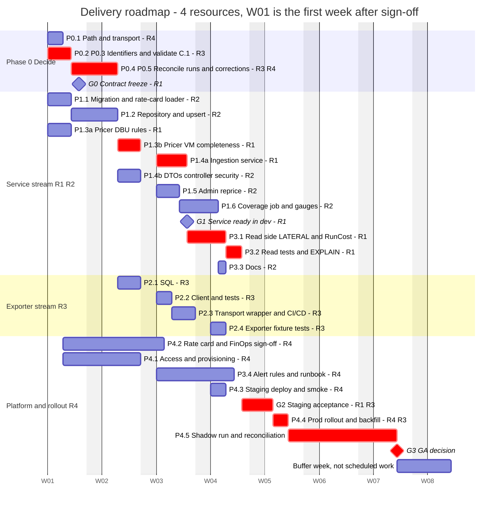

Weekly focus per person:

| | W1 | W2 | W3 | W4 | W5 | W6 | W7 |
|---|---|---|---|---|---|---|---|
| **R1** | Pricer (DBU), G0 | Pricer (VM) | Ingestion service, G1 | Read side, tests, EXPLAIN | G2, rollout support | Shadow-run support | G3 |
| **R2** | Migration, loader, repository | Repository, controller, security | Controller, admin reprice, coverage job | Coverage job, docs | Staging fixes | Tuning, reprice runs | Handover docs |
| **R3** | Phase 0 analysis | Reconcile, productionise SQL | Client, wrapper, fixture tests | Fixture tests, staging deploy | G2, backfill | Shadow reconciliation | Shadow reconciliation |
| **R4** | Path, transport, rate card | Access, provisioning, rate card | Rate card sign-off, alert rules | Staging deploy, alert rules, runbook | Prod rollout | Shadow run | Shadow run, G3 |

### H.5 Gates and exit criteria

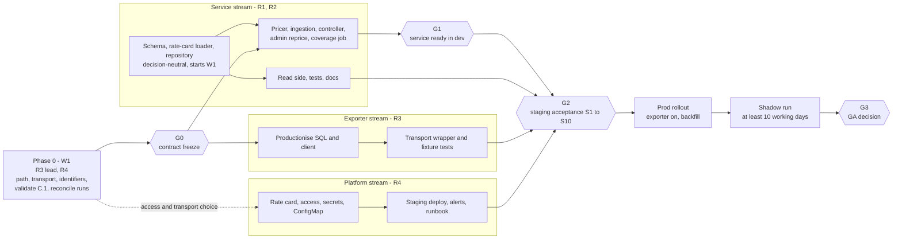

| Gate | When | Exit criteria |
|---|---|---|
| **G0 Contract freeze** | End W1 | Path = UC and transport recorded (B.3). Identifiers confirmed (tag vs `runId`, `task-id`, job-parameter key, MEG scoping predicate). Multi-task question answered. C.1 validated with a measured runtime. C.2 `schemaVersion=1` frozen. The telemetry source and threshold (P0.4) land by mid-W2 and affect only P1.3b and the threshold value |
| **G1 Service ready in dev** | End W3 | All F.5 repository, pricer, ingestion and controller tests green. A **Docker-enabled** run executes the JDBC tests (the last full run recorded in `tasks/todo.md` skipped 53 Testcontainers tests). A real Phase 0 payload gives the expected `ACCEPTED` / `REJECTED` / `linked` results |
| **G2 Staging acceptance** | W4–W5 | Scenarios S1–S10 below pass end to end |
| **G3 GA decision** | W7 | At least 10 working days in production (longer than `settle-days` = 7, so one full PROVISIONAL → SETTLED cycle is seen). `runs_missing_cost` = 0 for the last 7 days. `unpriced_rows` = 0. `unlinked` oldest < 48 h. `vm_incomplete` < 5 % of runs (F.6 threshold). No unexplained REJECTED. Reconciliation on a sample of at least 20 runs that covers all six Phase 0 categories: DBU quantities equal billing, and DBU $ and VM $ are within the tolerances agreed in P0.4 (proposal: DBU $ within rate-card rounding, VM $ within ±10 % per run against Azure Cost Management). Alert paths were exercised in staging (S5) |

**Staging scenarios (G2).**

| # | Scenario | Expected |
|---|---|---|
| S1 | Happy path: run exists, item arrives | `ACCEPTED`, `linked=true`, `PRICED`. `/executions` shows `cost` |
| S2 | Cost arrives before the run row | `linked=false`, then linked on read once the run appears. `unlinked_rows` returns to 0 |
| S3 | Hourly resend with a newer `asOf`, then an older one | Revision unchanged and repriced, then `STALE` |
| S4 | Late RETRACTION / RESTATEMENT replay | `revision` +1. A settled row stays `SETTLED`. Totals follow the nets |
| S5 | SKU missing from the rate card | `UNPRICED`, null total, `unpriced_rows` alert fires. After adding the SKU and running admin reprice: `PRICED`, alert clears. *(This is Part G Phase 0 step 6, which needs the service and so runs here.)* |
| S6 | Short run absent from `node_timeline` | `DBU_IMPLIED`, `PARTIAL`, VM cost never 0 |
| S7 | Exporter paused N days, then one run with `discovery_days = N + 2` | Every missed run recovered |
| S8 | Zero items, then 201 items | Heartbeat updates the export log only. 201 items go as two POSTs |
| S9 | Ambiguous tag and calculator mismatch | `REJECTED` with reason. Nothing stored. `items{status="REJECTED"}` counter moves |
| S10 | `/executions` with no cost rows, two attempts, and one unpriced attempt | `cost` null. Two priced attempts summed. With an unpriced attempt: `totalCost` null, `knownSubtotal` present, `complete=false` |

### H.6 Rollout and rollback

Each step is safe to stop at.

1. **Deploy the service with the exporter off** (staging, then prod). Flyway applies `V13`, which is additive. `/executions` is unchanged except for a null `cost`. The gauges are present. A bad rate card stops the new pods at startup (A.5 fail-fast), so the old pods keep serving.
2. **Smoke the exporter** in prod with `discovery_days = 1`. Check the item results, the export log and the gauges.
3. **Backfill** with one run at `discovery_days = history_days = 62`. The rate card must cover the oldest usage date, or those rows are `UNPRICED`. Fix the card and run admin reprice for the date range.
4. **Switch to the hourly default** (7 / 62). Alerts are **non-paging**.
5. **Shadow run and reconcile** until G3. Tune the completeness threshold and alert thresholds from real data.
6. **GA:** paging alerts on, runbook walkthrough, `docs/consumer-api.md` published.

| Failure | Response |
|---|---|
| Wrong prices | Fix the ConfigMap and restart the pods (the card is validated at startup). Run admin reprice. It changes valuation only, can be repeated, and never touches `revision` |
| Bad or missing source data | The next resend with a newer `asOf` overwrites the row. Recover a window with a catch-up run (D.6) |
| Exporter misbehaving | Stop the schedule. Nothing else changes: `cost` stays as last stored, and no reader depends on a new row |
| Service regression | Roll back the image. `V13` is additive and unused by the old code, so there is no data migration to revert |

### H.7 Risks

| # | Risk | Impact | Mitigation | Trigger |
|---|---|---|---|---|
| 1 | Unity Catalog system tables unavailable or stale | Path UC is not viable | B.3 decision in P0.1. Non-UC needs the B.2 spike before any estimate | Freshness query fails or is older than 1 day |
| 2 | `node_timeline` misses short nodes, so VM cost is incomplete | PARTIAL runs carry an upper-bound bias | Built into A.4. P0.4 evaluates `instance_events` (Public Preview, so also a stability risk) | `vm_incomplete` above 5 % |
| 3 | No representative runs exist (spot-evicted, repaired, retried) | P0.4 cannot decide the telemetry source | Trigger staged runs in the non-prod workspace. Budget up to 3 extra days | Missing category at the end of W1 |
| 4 | Rate-card inputs late (contract, discounts) | GA blocked on FinOps even though the code is done | UNPRICED by design plus admin reprice, so engineering is not blocked. Start P4.2 in W1 | Card unsigned by end of W3 |
| 5 | A static card cannot express reservations, savings plans or negotiated spot rates | VM $ deviates from the invoice | The card carries effective (amortised) rates. Tolerance agreed in P0.4. Documented limit (A.4) | Reconciliation outside tolerance |
| 6 | Exporter query is slow or costly at 7 / 62 days | Hourly run overruns, warehouse cost (Option 2) | Runtime measured in P0.3 and tuned in P2.1. Lower `history_days` if retention allows | Runtime above the Phase 0 budget |
| 7 | No network path from Databricks to the service (Option 1) or Airflow to the warehouse (Option 2) | Chosen transport blocked | D.3.6 health check in P0.1. The other option is the fallback. Effort is similar (about ±1 pd) | Health check fails |
| 8 | `/executions` slows down after the `LATERAL` join | Regression on an existing endpoint | Index on `(run_id, reporting_date)` exists. P3.2 `EXPLAIN` at about 10⁵ rows against baseline. The 5-minute cache absorbs repeats | `EXPLAIN` shows a sequential scan |
| 9 | Year-end freeze or leave overlaps W4–W7 | Soak stretches, GA slips | Pick the start date with the freeze in mind. If W4–W7 overlap it, add 1–2 weeks or start in January | Start date inside 4 weeks of the freeze |
| 10 | Docker-dependent tests silently skipped | The upsert and revision logic ships untested | G1 requires a Docker-enabled run. CI must have Testcontainers | A skipped-test count above zero |
| 11 | Revision 1 sections of Parts D and E are missing from the repo | Wrapper work (P2.3) starts from a gap | Recover Revision 1 or rewrite D.3, D.4, E.3 and E.8 before P2.3 (owner R3, by end W2) | Not resolved at start of W3 |

### H.8 Three-person variant

Drop R4. Platform work is spread so that no one person is on the critical path twice:

| Work moved from R4 | To | Added effort |
|---|---|---|
| P0.1 path and transport, console figures for P0.4 | R3 | +2.5 pd |
| P4.1 provisioning, P4.3 staging deploy, P3.4 alert rules and runbook, P4.4 rollout | R2 | +9 pd |
| P4.5 shadow reconciliation, G3 | R1 | +5 pd |
| P4.2 rate card | FinOps (non-engineering) with R1 review | +1 pd (R1) |

Resulting load: R1 about 25 pd, R2 about 25 pd, R3 about 22.5 pd. Effects:
- Phase 0 stretches by about half a week, because R3 carries the transport decision on top of the analysis.
- Alert rules and the runbook move behind the coverage job in R2's queue.
- **GA moves to about W8 and the buffer week is gone.** It is feasible, but it has no slack for risks 3, 4 or 9.

### H.9 Not in this roadmap

- **Non-UC path** (B.2): needs its own design spike. Built only if Phase 0 selects it.
- **Least privilege** on routes other than `/api/v1/compute-costs/**`, and replacing the plaintext `{noop}` passwords (F.3 open item, TD-7).
- **Retention** of `calculator_run_cost` beyond 395 days (F.1).
- **Serverless and pool compute** (excluded by A.1 #2).
- **Cost roll-ups, budgets and anomaly alerts** across calculators or days. This design delivers per-run cost on `/executions` only. Roll-ups would be a follow-up design.
