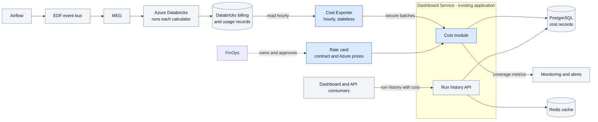
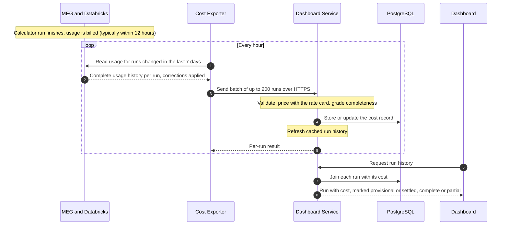
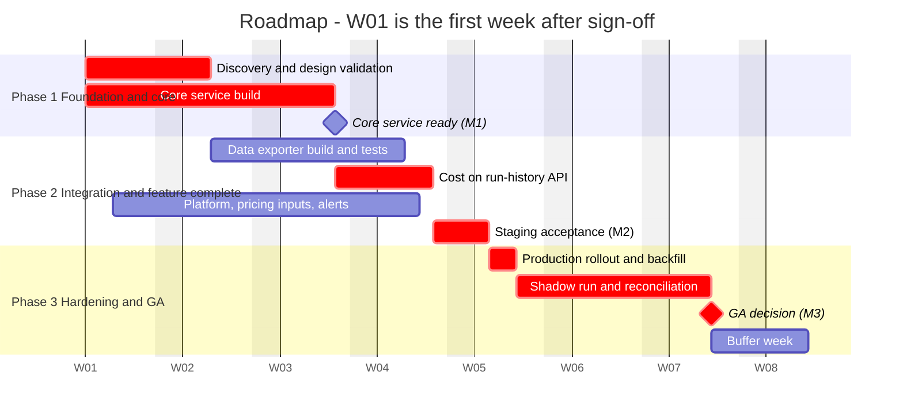

# Per-Run Databricks Compute Cost: High-Level Design, Estimate and Roadmap

**Audience:** Senior engineering leadership, product and VP stakeholders
**Status:** Draft for approval, 2026-11-20
**Detailed design:** [2026-11-19-cost-design.md](2026-11-19-cost-design.md) (Revision 2, with full architecture and work breakdown)

---

## 1. Executive Summary

**The problem.** Every calculator runs on Azure Databricks, but we cannot say what any single run costs. Spend is visible only as monthly totals, so teams cannot see which calculators drive it, and finance cannot trace an invoice line back to a run.

**The solution.** Attach a dollar cost (Databricks compute units plus the underlying Azure VMs) to every calculator run, and show it next to the runtime and SLA data the dashboard already serves. A small hourly job reads Databricks' own billing records and sends them to the existing Dashboard Service. The service prices them from a finance-approved rate card, stores them and serves them through the existing run-history API.

**Why this approach.** It reuses what we run today (Dashboard Service, PostgreSQL, Redis, Databricks). It adds no new infrastructure and no new vendor. Pricing lives in one place, so a price change is applied retroactively without re-collecting data.

**What leadership should know about accuracy.**
- **Compute-unit cost mirrors billing.** It is a direct multiplication of billed quantities by agreed rates.
- **VM cost is modelled.** Databricks telemetry can miss short-lived machines, so each run is labelled complete or partial. Unknown cost is shown as unknown, never as zero.
- **Cost is not real time.** A run's cost typically appears 12–13 hours after it finishes and is marked *provisional* for 7 days. Databricks can issue late corrections after that. The system absorbs them and keeps a revision count.

### At-a-glance

| | |
|---|---|
| **Target launch** | Kickoff + 7 weeks (8 weeks committed, including one buffer week) |
| **Total effort** | **14.8 person-weeks** planned, **17.8** with 20% contingency |
| **Team** | 4 roles: 2 backend, 1 data/Databricks, 1 platform/FinOps (part-time) |
| **Key dependencies** | Read access to Databricks billing tables. Finance-approved rate card. Network path from Databricks (or Airflow) to the service. Run-ID tagging by MEG |
| **Overall risk** | **Medium** (see section 6) |
| **New infrastructure** | None. Two new database tables (about 100,000 rows a year) and one scheduled job |

### Decisions requested

1. **Approve the team:** four roles for about 7 weeks, with the platform/FinOps engineer at 50–60%.
2. **Name a finance owner** to sign off the pricing inputs (contract rates, Azure prices) by the end of week 3. GA depends on it.
3. **Confirm the start date** against the year-end change freeze. A start within four weeks of the freeze adds 1–2 weeks.
4. **Agree the accuracy bar.** Proposal: compute-unit cost equals billing. VM cost within ±10% per run against Azure cost data.

---

## 2. High-Level Architecture and System Design

### 2.1 System context

Blue components are new. Everything else exists today.

### 2.2 Core data flow (happy path)

### 2.3 Data model and storage strategy

- **Two new tables in the existing PostgreSQL.** One holds one cost record per Databricks run (about 100,000 a year, so no partitioning is needed). One holds the exporter's heartbeat and diagnostics, pruned at 30 days.
- **Cost is linked to a run at read time**, not at write time. Cost can therefore arrive before or after the run record without loss, and no retry queue is needed.
- **Each record keeps its raw usage.** A rate change is reapplied from stored data with one admin action, with no re-export. Pricing history is effective-dated, so a run that spans a price change is costed correctly.
- **Every record is revisable.** Corrections raise a revision counter. "Settled" is computed from time (7 days after the run ends), not stored, so it cannot go stale.
- **Caching reuses the existing Redis layer** for run history. A cost update refreshes the cache automatically. The 5-minute cache lifetime bounds how late a provisional-to-settled change shows.
- **Open item:** retention beyond 395 days is to be decided during build.

### 2.4 Key architectural decisions and trade-offs

Ratings are the architect's assessment. For Complexity and Cost, lower is better.

| Decision | Option | Complexity | Scalability | Time-to-market | Cost | Verdict |
|---|---|---|---|---|---|---|
| **Data source** | **Databricks billing and usage tables** | Low | High: one query covers all runs | Fast | Low | **Chosen** |
| | Poll the Databricks jobs API run by run | High: call volume, rate limits, data lost after cluster cleanup | Low | Medium | Medium | Fallback only, needs its own design |
| **Where prices live** | **Service-side rate card** | Low | High | Fast | Low | **Chosen**: reprice without re-export |
| | Price inside the exporter | Medium: every price change needs a re-export | Medium | Fast | Low | Rejected |
| **Finding new data** | **Hourly rescan of the last 7 days** | Low: no state to lose | High at this volume | Fast | Low | **Chosen**: late corrections are caught by design |
| | Incremental watermark | Medium: state to repair after outages | High | Medium | Low | Rejected |
| **Run linkage** | **Store everything, link at read time** | Low | High | Fast | Low | **Chosen** |
| | Reject until the run record exists, then replay | High | Medium | Slow | Medium | Rejected |
| **Delivery transport** | Databricks job posts directly | Medium | High | Medium | Low | **Open.** Decide in week 1 |
| | Airflow pulls, then posts | Medium | High | Medium | Medium: SQL warehouse time | **Open.** Decide in week 1 |

The transport decision turns on connectivity, who is on call for Databricks jobs versus Airflow, and existing deployment tooling. The effort difference is about one person-day.

---

## 3. Security, Scalability and Operational Readiness

**Security**
- The exporter has its own identity with a single permission: submit cost data. Repricing needs a separate admin role.
- Transport is HTTPS only. Credentials sit in Databricks or Airflow secret stores. The rate-card file holds prices and no secrets.
- The exporter has read-only access to the Databricks billing tables and nothing else.
- **Known gap, inherited:** the service's existing basic-authentication scheme stores passwords in plain configuration. Fixing it is out of scope and is tracked as technical debt.

**Scalability**
- Volume is small: about 100,000 cost records a year, sent in batches of up to 200. No new capacity is needed.
- The hourly rescan recomputes seven days of runs. At this volume that is trivial, and it is what makes the design self-healing.
- The new run-history lookup uses an indexed join and the existing cache. It is verified against the current response time before release.

**Failure modes**
- **Network or service failure:** the exporter retries with back-off. Every send is safe to repeat. A stale resend is ignored.
- **Exporter outage:** one catch-up run with a wider window recovers all missed runs.
- **Missing price:** the run is stored as *unpriced* and totals show as unknown. Add the price, run one admin action, and it is corrected. The system never invents a zero.
- **Incomplete Databricks telemetry:** the run is flagged *partial* and carries a conservative upper-bound estimate.

**Observability**
- Coverage metrics, not just activity: runs with no cost after 24 hours, cost records with no matching run, unpriced records, partial-VM share, exporter freshness, unattributed Databricks spend.
- Alerts start as non-paging and become paging at GA, after thresholds are tuned on real data.

**Rollout strategy**
- **No feature flag is needed.** The API change is additive, and a run without cost simply shows none.
- **Staged enablement instead:** deploy the service with the exporter off, smoke-test with one day of data, backfill 62 days, then run in shadow mode for at least 10 working days before GA.
- **Rollback is simple:** stop the exporter. The new tables are additive, so there is no data migration to undo.

---

## 4. Effort Estimation

Sizes: **S** under 2 person-weeks, **M** 2–4, **L** 4–6, **XL** over 6.

| Workstream | Key deliverables | T-shirt size | Est. effort (person-weeks) | Confidence |
|---|---|---|---|---|
| **Discovery and design validation** | Transport decision. Confirm identifiers and reporting-date source. Validate the data on real Databricks runs. Reconcile six representative run types against billing | S | 1.8 | Medium |
| **Core backend: ingestion and pricing** | Cost data model. Ingestion API with validation. Pricing engine (compute units and VMs, effective-dated rates). Admin reprice. Security role | **L** | 4.3 | High |
| **Data integration: exporter** | Billing-data query with correction handling. Delivery client with retries. Scheduled job or DAG. Fixture tests | M | 2.0 | Medium |
| **API: cost on run history** | Cost on the existing run-history response. Unknown-safe totals. Performance check. Consumer documentation | S | 1.2 | High |
| **Observability and operations** | Coverage monitoring. Alert rules. Runbook | S | 1.2 | High |
| **Platform, access and pricing inputs** | Billing-table access, secrets, network path. Rate card from contract and Azure prices. Staging environment | S | 1.4 | Medium |
| **QA, rollout and shadow run** | 10-scenario staging acceptance. Production rollout and 62-day backfill. 10-working-day shadow run with reconciliation. GA sign-off | M | 2.9 | Medium |
| **Planned total** | | | **14.8** | |
| **Contingency (20%)** | Unknowns: data quirks, approvals, rework | | **+3.0** | |
| **Total with contingency** | | | **17.8** | |

**Assumptions**
- Individual estimates carry ±30%. The 20% contingency is held on top.
- **Capacity is not the constraint.** 17.8 person-weeks is about 72% of what this team delivers in 7 weeks (3.5 full-time equivalents). The calendar is set by dependencies and the mandatory production soak.
- Work that does not depend on the week-1 decisions (database schema, price loading, repository, the compute-unit half of pricing) starts immediately. Contract-dependent work waits for the end-of-week-1 design freeze. A strict "nothing before the freeze" rule adds about one week.
- Databricks billing tables are available (the Unity Catalog path). If not, a separate design spike is required first and this estimate is void.
- Dev, staging and production environments exist, and a non-production Databricks workspace is available.
- **Out of scope:** cost roll-ups, budgets and anomaly alerts. Serverless compute. Hardening the existing authentication scheme.
- **Three-person variant:** drop the platform/FinOps role. GA moves to about week 8 and the buffer week is consumed.

---

## 5. Phased Implementation Roadmap

Weeks count from sign-off (W01 is the first week). Red bars are the critical path.

| Phase | Weeks | Scope | Exit criteria |
|---|---|---|---|
| **1. Foundation and core** | W1–W3 | Decisions and design freeze. Ingestion, pricing and storage built and tested | Transport and data source decided. Identifiers confirmed. Pricing and ingestion pass automated tests, **including the database-backed tests, not skipped**. A real Databricks sample is priced end to end in the dev environment |
| **2. Integration and feature complete** | W3–W5 | Exporter built. Cost on the run-history API. Rate card approved. Alerts and runbook. Staging deployment | Exporter and service run together in staging. Ten acceptance scenarios pass (late corrections, missing prices, outage recovery, short runs, bad data). Existing run-history response time does not regress. Rate card signed off |
| **3. Hardening and GA** | W5–W7 | Production rollout, 62-day backfill, shadow run, reconciliation, paging alerts | At least 10 working days in production. No run missing cost for 7 days. No unpriced records. Under 5% of runs with partial VM cost. Sample of 20 or more runs reconciled within the agreed accuracy bar. Runbook accepted |

---

## 6. Risks, Dependencies and Mitigations

| # | Risk | Likelihood | Impact | Mitigation |
|---|---|---|---|---|
| 1 | **Databricks billing tables unavailable or stale** | Low | High | Checked in week 1. The fallback path is a separate design effort and is not in this estimate |
| 2 | **Pricing inputs late or unsigned** (contract rates, discounts) | Medium | High: blocks GA | Finance owner named now. Work starts in week 1. Unpriced runs are flagged and fixed retroactively, so engineering is not blocked |
| 3 | **VM cost cannot be fully measured** (Databricks telemetry gaps) | High (known) | Medium | Every run carries a completeness flag. Gaps are filled with a conservative estimate. A second Databricks data source is evaluated in week 1. Accuracy bar agreed up front |
| 4 | **A static rate card cannot express reservations or negotiated discounts** | Medium | Medium | Card carries effective rates. Variance checked in the shadow run. Documented limit |
| 5 | **Access or network approvals slow down** (billing-table access, service connectivity) | Medium | Medium | Requested in week 1. Health check before any build. Both transport options are viable, so one can substitute for the other |
| 6 | **Calendar and capacity:** year-end freeze, part-time FinOps role | Medium | Medium | Set the start date against the freeze. One buffer week. Planned load is about 72% of capacity |
| 7 | **Existing run-history endpoint slows down** | Low | Medium | Indexed join, existing cache, measured against a baseline before release |
| 8 | **Design documentation gap:** parts of Revision 1 are missing | Medium | Low | Recover or rewrite before the exporter work starts, owner assigned in week 2 |

**External dependencies:** Databricks account and workspace administrators (access), finance (pricing inputs), the MEG team (run-ID tagging confirmation), and platform operations (secrets and deployment).
